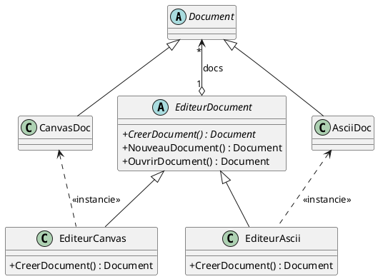
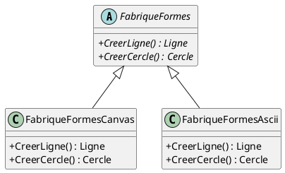

# Patrons de conception : Création (Première Partie)

## Fabrique (*Factory Method*, *Virtual Constructor*)

### Intention {id="intention_1"}

Définir une interface pour créer un objet, mais laisser les sous-classes décider
quelle classe concrète instancier. La méthode de fabrique permet à une classe de
déléguer la responsabilité de l'instanciation à ses sous-classes.

### Mise en contexte {id="mise-en-contexte_1"}

Considérons une application de dessin (éditeur graphique) capable de manipuler
différents types de documents, par exemple :

- des documents sur canevas graphique (`CanvasDoc`, voir `ShapesLib`),
- des documents en art ASCII (`AsciiDoc`).

L'interface générale de l'application (barre de menu, gestion des fichiers,
raccourcis) doit pouvoir orchestrer les opérations communes (créer un nouveau document,
ouvrir, fermer, sauvegarder) sans être couplée aux classes concrètes de chaque format.

### Détails {id="d-tails_1"}

#### Pourquoi le nom `Application` peut porter à confusion

Dans la littérature classique du *Gang of Four* (GoF), la classe de base créatrice
est souvent nommée `Application`. Toutefois, dans le développement moderne (notamment
avec des cadriciels comme Qt/PySide), le terme `Application` (`QApplication`) désigne
déjà le processus global ou la boucle d'événements du programme.

Pour éviter toute ambiguïté, on modélise plutôt le créateur sous le rôle d'un
**gestionnaire de documents** ou d'un **éditeur** (`EditeurDocument` ou `DocumentEditor`).

#### Structure et fonctionnement

Le patron repose sur deux hiérarchies parallèles :

1. **Hiérarchie des Produits (ce qui est créé) :**
    - `Document` : classe abstraite représentant un document générique.
    - `CanvasDoc` et `AsciiDoc` : sous-classes concrètes implémentant les spécificités de chaque format.

2. **Hiérarchie des Créateurs (ce qui crée et manipule les produits) :**
    - `EditeurDocument` : classe abstraite qui définit la logique générale (ex. `NouveauDocument()`, `OuvrirDocument()`) et déclare la méthode de fabrique abstraite `CreerDocument()`.
    - `EditeurCanvas` et `EditeurAscii` : sous-classes concrètes qui redéfinissent la méthode de fabrique `CreerDocument()` pour instancier et retourner le type exact de document (`CanvasDoc` ou `AsciiDoc`).

#### Flux d'exécution et bénéfices

1. Lorsque l'utilisateur sélectionne *Nouveau Document*, la méthode `NouveauDocument()` de `EditeurDocument` est appelée.
2. `NouveauDocument()` exécute la logique commune (ex. initialisation de l'affichage, suivi de l'état) et appelle la méthode abstraite `CreerDocument()`.
3. Grâce au **polymorphisme**, c'est la sous-classe active (`EditeurCanvas` ou `EditeurAscii`) qui instancie le bon type de document sans que le code générique n'ait à connaître les classes concrètes.
4. **Avantages clés :**
    - **Élimination des branchements conditionnels :** évite d'éparpiller des `if / switch` basés sur le type de format dans toute l'interface graphique.
    - **Respect du principe Ouvert/Fermé (OCP) :** pour ajouter un nouveau format (ex. `SvgDoc`), il suffit de créer `SvgDoc` et `EditeurSvg` sans modifier le code générique existant.

-------------------------------------------------------------------------------

## Fabrique Abstraite (*Abstract Factory*, *Kit*)

### Intention

Donner une interface pour créer une famille d'objets semblables ou dépendants
sans spécifier leur classe concrète.

### Mise en contexte

Continuation de l'exemple précédent : pour dessiner des figures géométriques
(les `Shape`s : lignes, cercles, rectangles), doit-on créer des figures adaptées au
`Canvas` ou des figures adaptées à l'art `Ascii` ?

Pour que les outils de dessin et les boutons puissent créer des formes compatibles
avec le document courant sans utiliser de `if / switch`, on encapsule la création
de toute la famille de formes dans une fabrique abstraite.

### Détails

1. Lorsqu'un bouton d'outil (ex. outil "Ligne" ou "Cercle") est cliqué :
    - On veut créer la bonne forme sans vérifier manuellement le type de document actif.
2. On définit une interface abstraite `FabriqueFormes` (ou `ShapeFactory`) avec des méthodes pour chaque type de figure (`CreerLigne()`, `CreerCercle()`, etc.).
3. Deux fabriques concrètes implémentent cette interface :
    - `FabriqueFormesCanvas` : crée des formes pour le canevas graphique.
    - `FabriqueFormesAscii` : crée des formes textuelles ASCII.
4. Chaque éditeur (`EditeurCanvas`, `EditeurAscii`) fournit ou utilise la fabrique concrète correspondant à son format.
5. Le code de l'interface (gestionnaires d'événements, boutons, raccourcis) interagit uniquement avec l'interface `FabriqueFormes` :
    - `editeur.fabriqueFormes.CreerLigne()` retourne la ligne appropriée au contexte d'exécution.

!!! info "Démo"
      [Implémentation démo des 2 patrons](../src/section6/dessin/app.py)