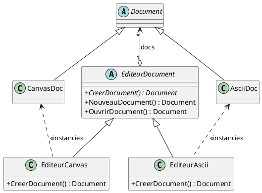
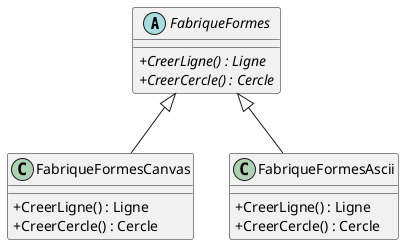

# Patrons de conception : Création (Première Partie)

## Fabrique (*Factory Method*, *Virtual Constructor*)

### Intention {id="intention_1"}

Définir une interface pour créer un objet, mais laisser les sous-classes décider
quelle classe concrète instancier. La méthode de fabrique permet à une classe de
déléguer la responsabilité de l'instanciation à ses sous-classes.

### Mise en contexte {id="mise-en-contexte_1"}

Considérons une application de dessin (éditeur graphique) capable de manipuler
différents types de documents, par exemple :

- des documents sur canevas graphique (`CanvasDoc`, voir `ShapesLib`),
- des documents en art ASCII (`AsciiDoc`).

L'interface générale de l'application (barre de menu, gestion des fichiers,
raccourcis) doit pouvoir orchestrer les opérations communes (créer un nouveau document,
ouvrir, fermer, sauvegarder) sans être couplée aux classes concrètes de chaque format.

!!! tip "En bref : Fabrique ou Fabrique abstraite ?"
    - **Fabrique (*Factory Method*)** : la classe de l'éditeur détermine le produit. On choisit `EditeurCanvas` ou `EditeurAscii`, et chacun redéfinit `CreerDocument()`.
    - **Fabrique abstraite (*Abstract Factory*)** : l'objet fabrique fourni à l'éditeur détermine la famille de produits. On choisit `FabriqueFormesCanvas` ou `FabriqueFormesAscii` et on les branche sur l'éditeur, sans créer de nouvelle sous-classe d'éditeur.

    Question utile : « Un seul objet varie-t-il, ou une famille d'objets liés doit-elle rester cohérente ? »


### Détails {id="d-tails_1"}

#### Pourquoi le nom `Application` peut porter à confusion

Dans la littérature classique du *Gang of Four* (GoF), la classe de base créatrice
est souvent nommée `Application`. Toutefois, dans le développement moderne (notamment
avec des cadriciels comme Qt/PySide), le terme `Application` (`QApplication`) désigne
déjà le processus global ou la boucle d'événements du programme.

Pour éviter toute ambiguïté, on modélise plutôt le créateur sous le rôle d'un
**gestionnaire de documents** ou d'un **éditeur** (`EditeurDocument` ou `DocumentEditor`).

#### Structure et fonctionnement

Le patron repose sur deux hiérarchies parallèles :

1. **Hiérarchie des Produits (ce qui est créé) :**
    - `Document` : classe abstraite représentant un document générique.
    - `CanvasDoc` et `AsciiDoc` : sous-classes concrètes implémentant les spécificités de chaque format.

2. **Hiérarchie des Créateurs (ce qui crée et manipule les produits) :**
    - `EditeurDocument` : classe abstraite qui définit la logique générale (ex. `NouveauDocument()`, `OuvrirDocument()`) et déclare la méthode de fabrique abstraite `CreerDocument()`.
    - `EditeurCanvas` et `EditeurAscii` : sous-classes concrètes qui redéfinissent la méthode de fabrique `CreerDocument()` pour instancier et retourner le type exact de document (`CanvasDoc` ou `AsciiDoc`).

#### Flux d'exécution et bénéfices

1. Lorsque l'utilisateur sélectionne *Nouveau Document*, la méthode `NouveauDocument()` de `EditeurDocument` est appelée.
2. `NouveauDocument()` exécute la logique commune (ex. initialisation de l'affichage, suivi de l'état) et appelle la méthode abstraite `CreerDocument()`.
3. Grâce au **polymorphisme**, c'est la sous-classe active (`EditeurCanvas` ou `EditeurAscii`) qui instancie le bon type de document sans que le code générique n'ait à connaître les classes concrètes.
4. **Avantages clés :**
    - **Élimination des branchements conditionnels :** évite d'éparpiller des `if / switch` basés sur le type de format dans toute l'interface graphique.
    - **Respect du principe Ouvert/Fermé (OCP) :** pour ajouter un nouveau format (ex. `SvgDoc`), il suffit de créer `SvgDoc` et `EditeurSvg` sans modifier le code générique existant.



-------------------------------------------------------------------------------

## Fabrique Abstraite (*Abstract Factory*, *Kit*)

### Intention

Donner une interface pour créer une famille d'objets semblables ou dépendants
sans spécifier leur classe concrète.

### Mise en contexte

Continuation de l'exemple précédent : pour dessiner des figures géométriques
(les `Shape`s : lignes, cercles, rectangles), doit-on créer des figures adaptées au
`Canvas` ou des figures adaptées à l'art `Ascii` ?

Pour que les outils de dessin et les boutons puissent créer des formes compatibles
avec le document courant sans utiliser de `if / switch`, on encapsule la création
de toute la famille de formes dans une fabrique abstraite.

Pour éviter la confusion avec le patron précédent, on parle ici de « fabrique abstraite » (ou « fabrique de formes ») et on réserve l'expression « méthode de fabrique » à la section précédente. Dans cet exemple, `Ligne` et `Cercle` sont deux sous-types de `Forme` : chacun existe en variante canvas et en variante ASCII, et ce sont ces variantes que les fabriques concrètes produisent.

### Détails

1. Lorsqu'un bouton d'outil (ex. outil "Ligne" ou "Cercle") est cliqué :
    - On veut créer la bonne forme sans vérifier manuellement le type de document actif.
2. On définit une interface abstraite `FabriqueFormes` (ou `ShapeFactory`) avec des méthodes pour chaque type de figure (`CreerLigne()`, `CreerCercle()`, etc.).
3. Deux fabriques concrètes implémentent cette interface :
    - `FabriqueFormesCanvas` : crée des formes pour le canevas graphique.
    - `FabriqueFormesAscii` : crée des formes textuelles ASCII.
4. Chaque éditeur (`EditeurCanvas`, `EditeurAscii`) fournit ou utilise la fabrique concrète correspondant à son format : `EditeurCanvas` associe `FabriqueFormesCanvas` et `EditeurAscii` associe `FabriqueFormesAscii`, via l'attribut `fabriqueFormes` de l'éditeur. C'est le cas le plus fréquent en pratique : les deux patrons sont combinés, la méthode de fabrique choisissant l'éditeur et la fabrique abstraite choisissant la famille de formes.
5. Le code de l'interface (gestionnaires d'événements, boutons, raccourcis) interagit uniquement avec l'interface `FabriqueFormes` :
    - `editeur.fabriqueFormes.CreerLigne()` retourne la ligne appropriée au contexte d'exécution.



### Différence avec la Fabrique (*Factory Method*)

La méthode de fabrique répond à la question « quelle classe de document créer ? » : une méthode, redéfinie par chaque sous-classe, crée un seul produit. La fabrique abstraite répond à la question « quelles classes de formes créer, de façon cohérente ? » : un objet fabrique complet, fourni par composition, crée plusieurs produits liés entre eux. Dans les deux cas, le client ne manipule que des interfaces abstraites ; la différence tient à ce qui varie (un produit isolé ou une famille) et au mécanisme de variation (héritage ou composition).

| Critère | Fabrique (*Factory Method*) | Fabrique abstraite (*Abstract Factory*) |
|---|---|---|
| Produits créés | Un seul type (`Document`) | Une famille (`Ligne`, `Cercle`, ...) |
| Mécanisme de variation | Héritage du créateur (redéfinition de `CreerDocument()`) | Composition (objet fabrique injecté ou fourni) |
| Qui décide de la classe concrète | La sous-classe de l'éditeur | L'objet fabrique concret |
| Garantie | Chaque document est créé par son éditeur | Toutes les formes créées proviennent de la même famille |
| Exemple du document | `EditeurCanvas` / `EditeurAscii` | `FabriqueFormesCanvas` / `FabriqueFormesAscii` |

#### Compromis d'extension

- Ajouter un **format de document** (ex. `SvgDoc` et `EditeurSvg`) relève de la méthode de fabrique : il suffit d'ajouter une sous-classe de créateur, sans modifier le code existant.
- Ajouter un **type de figure** (ex. `Rectangle`) relève de la fabrique abstraite : il faut ajouter `CreerRectangle()` dans `FabriqueFormes` et dans toutes les fabriques concrètes.

### Exemples dans d'autres contextes

Les deux patrons ne se limitent pas à l'éditeur graphique. Les exemples suivants montrent la structure ; ils ne sont pas exécutables tels quels.

#### Quel patron dans quel cas ?

| Contexte | Patron utilisé | Ce qui varie | Mécanisme de variation | Pourquoi ce patron |
|---|---|---|---|---|
| Export de données (bureau) | Fabrique (*Factory Method*) | Un seul objet : le format d'export | Héritage (`ExporteurCsv`, `ExporteurJson`) | Un seul produit varie, la logique d'export reste commune |
| Ennemis d'un niveau (PyGame) | Fabrique (*Factory Method*) | Un seul objet : l'ennemi | Héritage (`NiveauForet`, `NiveauDesert`) | Seul l'ennemi change d'un niveau à l'autre |
| Thème clair ou sombre (bureau) | Fabrique abstraite (*Abstract Factory*) | Une famille de widgets (bouton, champ) | Composition (fabrique fournie à la fenêtre) | Les widgets d'une fenêtre doivent appartenir au même thème |
| Moteur de base de données (gestionnaire) | Fabrique abstraite (*Abstract Factory*) | Une famille : connexion, générateur SQL, gestion du schéma | Composition (fabrique fournie au gestionnaire) | Les trois objets doivent appartenir au même moteur |
| Monde de jeu (PyGame) | Fabrique abstraite (*Abstract Factory*) | Une famille : décor, ennemi, musique | Composition (fabrique fournie au moteur de jeu) | Le décor, l'ennemi et la musique doivent correspondre |

Repère : si un seul objet varie, on utilise la méthode de fabrique. Si plusieurs objets liés doivent rester cohérents entre eux, on utilise la fabrique abstraite.

#### Fabrique (*Factory Method*) : un seul produit varie

##### Application bureau : export de données

Un gestionnaire de données peut exporter une liste d'enregistrements en CSV ou en JSON. La logique d'export est commune, seul le format change. Chaque sous-classe d'exporteur redéfinit `creer_format()`.

```python
from abc import ABC, abstractmethod

class Exporteur(ABC):
    @abstractmethod
    def creer_format(self):
        ...

    def exporter(self, lignes, chemin):
        self.creer_format().ecrire(lignes, chemin)

class ExporteurCsv(Exporteur):
    def creer_format(self):
        return FormatCsv()

class ExporteurJson(Exporteur):
    def creer_format(self):
        return FormatJson()
```

Ajouter un format XML revient à ajouter `ExporteurXml` et `FormatXml`, sans toucher à `exporter()`. Ici, un seul objet varie (le format), donc la méthode de fabrique suffit.

##### Jeu PyGame : chaque niveau crée ses ennemis

La classe de niveau sait quel type d'ennemi faire apparaître. `generer_vague()` contient la logique commune, et `creer_ennemi()` est redéfinie par chaque niveau.

```python
class Niveau(ABC):
    @abstractmethod
    def creer_ennemi(self, x, y):
        ...

    def generer_vague(self, n):
        return [self.creer_ennemi(100 + i * 80, 50) for i in range(n)]

class NiveauForet(Niveau):
    def creer_ennemi(self, x, y):
        return Loup(x, y)

class NiveauDesert(Niveau):
    def creer_ennemi(self, x, y):
        return Scorpion(x, y)
```

Le moteur de jeu appelle `generer_vague()` sans savoir s'il est dans la forêt ou dans le désert. Si le décor et la musique devaient aussi changer, il faudrait passer à la fabrique abstraite (voir ci-dessous).

#### Fabrique abstraite (*Abstract Factory*) : une famille cohérente varie

##### Application bureau : thème clair ou sombre

Tous les widgets d'une fenêtre doivent être dans le même thème. Une fabrique fournie au constructeur de la fenêtre crée toute la famille, et la fenêtre ne contient aucun `if theme == "sombre"`.

```python
class FabriqueWidgets(ABC):
    @abstractmethod
    def creer_bouton(self, texte):
        ...

    @abstractmethod
    def creer_champ(self):
        ...

class FabriqueWidgetsSombre(FabriqueWidgets):
    def creer_bouton(self, texte):
        return BoutonSombre(texte)

    def creer_champ(self):
        return ChampSombre()

class FenetrePrincipale:
    def __init__(self, fabrique: FabriqueWidgets):
        self.bouton_ok = fabrique.creer_bouton("OK")
        self.champ_nom = fabrique.creer_champ()

FenetrePrincipale(FabriqueWidgetsSombre())
```

La composition fait le choix : on branche une autre fabrique, sans créer de nouvelle sous-classe de fenêtre. Pourquoi une fabrique abstraite et non une méthode de fabrique ? Parce que la fenêtre crée deux produits (un bouton et un champ) qui doivent appartenir au même thème. Une méthode de fabrique redéfinie séparément pour chaque widget ne garantirait pas cette cohérence.

##### Gestionnaire de données : moteur de base de données

Un gestionnaire de données supporte SQLite et PostgreSQL. Pour fonctionner, il a besoin de trois objets qui doivent aller ensemble :

- la **connexion** à la base (ouverture, exécution de requêtes) ;
- le **générateur SQL** (syntaxe des requêtes, qui diffère d'un moteur à l'autre) ;
- la **gestion du schéma** (création des tables, types de colonnes).

Une `FabriqueSqlite` et une `FabriquePostgres` fournissent chacune une famille complète. Le gestionnaire ne contient aucun `if moteur == "postgres"` : il reçoit une fabrique et utilise les trois objets sans connaître leurs classes concrètes.

```python
class FabriqueBaseDeDonnees(ABC):
    @abstractmethod
    def creer_connexion(self, parametres):
        ...

    @abstractmethod
    def creer_generateur_sql(self):
        ...

    @abstractmethod
    def creer_gestion_schema(self, connexion):
        ...

class FabriqueSqlite(FabriqueBaseDeDonnees):
    def creer_connexion(self, parametres):
        return ConnexionSqlite(parametres["fichier"])

    def creer_generateur_sql(self):
        return GenerateurSqlSqlite()

    def creer_gestion_schema(self, connexion):
        return SchemaSqlite(connexion)

class FabriquePostgres(FabriqueBaseDeDonnees):
    def creer_connexion(self, parametres):
        return ConnexionPostgres(parametres["hote"], parametres["base"])

    def creer_generateur_sql(self):
        return GenerateurSqlPostgres()

    def creer_gestion_schema(self, connexion):
        return SchemaPostgres(connexion)

class GestionnaireDonnees:
    def __init__(self, fabrique: FabriqueBaseDeDonnees, parametres):
        self.connexion = fabrique.creer_connexion(parametres)
        self.generateur = fabrique.creer_generateur_sql()
        self.schema = fabrique.creer_gestion_schema(self.connexion)

    def enregistrer(self, table, enregistrement):
        requete = self.generateur.insertion(table, enregistrement)
        self.connexion.executer(requete)

GestionnaireDonnees(FabriqueSqlite(), {"fichier": "clients.db"})
GestionnaireDonnees(FabriquePostgres(), {"hote": "srv-db", "base": "clients"})
```

##### Pourquoi une fabrique abstraite et pas une fabrique tout court ?

Le gestionnaire crée trois objets liés, alors qu'une méthode de fabrique ne couvre qu'un seul produit. On pourrait contourner le problème avec une sous-classe de gestionnaire par moteur (`GestionnaireSqlite`, `GestionnairePostgres`), mais deux défauts apparaissent :

- chaque méthode de création est redéfinie séparément, donc rien n'empêche une sous-classe de combiner une connexion SQLite avec un générateur PostgreSQL ;
- le choix du moteur est figé dans une sous-classe : chaque nouvelle combinaison exige une nouvelle classe de gestionnaire.

Avec la fabrique abstraite, le choix du moteur se fait en un seul endroit, par la fourniture d'un objet unique. Tous les produits sortent de la même fabrique, donc la cohérence de la famille est garantie par construction.

##### Jeu PyGame : thème de monde

Une fabrique par monde (`FabriqueMondeForet`, `FabriqueMondeDesert`) fournit le décor, les ennemis et la musique, qui doivent correspondre entre eux. Un loup dans un décor désertique serait incohérent.

```python
class FabriqueMonde(ABC):
    @abstractmethod
    def creer_decor(self): ...
    @abstractmethod
    def creer_ennemi(self): ...
    @abstractmethod
    def chemin_musique(self) -> str: ...

class FabriqueMondeForet(FabriqueMonde):
    def creer_decor(self):
        return Decor("foret.png")
    def creer_ennemi(self):
        return Loup()
    def chemin_musique(self):
        return "foret.ogg"
```

Ici, trois produits liés varient ensemble : c'est une fabrique abstraite. Si seul l'ennemi changait d'un niveau à l'autre, une méthode de fabrique suffirait, comme dans l'exemple du niveau PyGame plus haut.

!!! info "Démo"
      [Implémentation démo des 2 patrons](../src/section6/dessin/app.py)