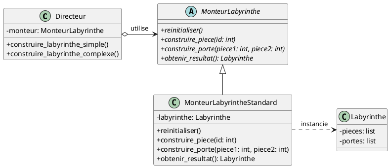
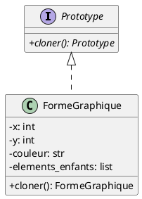
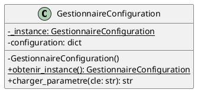

# Patrons de conception : Création (Deuxième Partie)

Dans ce chapitre, nous explorons trois autres patrons de conception de création du *Gang of Four* (GoF) : le **Monteur**
(*Builder*), le **Prototype** et le **Singleton**.

Nous analyserons leur intention d'origine, leur implémentation, ainsi que leurs **limites critiques** et leur **degré de
pertinence dans les langages multiparadigmes modernes** (comme Python, Kotlin ou TypeScript).

---

## Monteur (*Builder*)

### Intention {id="intention_1"}

Séparer la construction d'un objet complexe de sa représentation finale, de façon à ce que le même processus de
construction puisse produire différentes représentations ou configurations de l'objet étape par étape.

### Mise en contexte {id="mise-en-contexte_1"}

#### Différence avec les Fabriques

* **Fabrique Abstraite (*Abstract Factory*)** : se concentre sur la création immédiate de **familles d'objets complets**
  (ex. créer un ensemble cohérent de boutons, fenêtres et menus pour un thème donné).
* **Monteur (*Builder*)** : se concentre sur la **construction pas-à-pas** d'un seul objet complexe comportant de
  multiples composants, étapes ou options de configuration.

### Structure et fonctionnement {id="d-tails_1"}

Le patron repose traditionnellement sur quatre acteurs :

1. **Monteur Abstrait (`Monteur`)** : définit les étapes communes de construction (ex. `ajouter_salle()`,
   `ajouter_porte()`).
2. **Monteur Concret (`MonteurLabyrintheStandard`, `MonteurLabyrinthePiege`)** : implémente les étapes et assemble
   l'objet final.
3. **Directeur (`DirecteurJeu`)** : orchestre l'ordre d'exécution des étapes de construction.
4. **Produit (`Labyrinthe`)** : l'objet résultant complexe.



#### Exemple d'utilisation moderne (Interface fluide / *Method Chaining*)

En pratique, le directeur est souvent omis au profit d'un chaînage de méthodes direct (*Fluent Interface*) :

```python
class RequeteHttp:
    def __init__(self):
        self.url = ""
        self.methode = "GET"
        self.en_tetes = {}
        self.corps = None
        self.timeout = 30


class RequeteHttpMonteur:
    def __init__(self):
        self._requete = RequeteHttp()

    def avec_url(self, url: str) -> "RequeteHttpMonteur":
        self._requete.url = url
        return self

    def avec_methode(self, methode: str) -> "RequeteHttpMonteur":
        self._requete.methode = methode
        return self

    def avec_en_tete(self, cle: str, valeur: str) -> "RequeteHttpMonteur":
        self._requete.en_tetes[cle] = valeur
        return self

    def avec_timeout(self, secondes: int) -> "RequeteHttpMonteur":
        self._requete.timeout = secondes
        return self

    def construire(self) -> RequeteHttp:
        # Validation possible avant livraison
        if not self._requete.url:
            raise ValueError("L'URL est obligatoire.")
        return self._requete


# Utilisation fluide :
requete = (
    RequeteHttpMonteur()
    .avec_url("https://api.exemple.com/donnees")
    .avec_methode("POST")
    .avec_en_tete("Authorization", "Bearer token123")
    .avec_timeout(10)
    .construire()
)
```

### Problèmes potentiels et limites

* **Prolifération de code standard (*Boilerplate*)** : Nécessite la création de classes supplémentaires pour chaque
  produit, dupliquant souvent la liste des attributs.
* **Complexité inutile pour les objets simples** : Imposer un monteur lorsque l'objet ne possède que 2 ou 3 paramètres
  nuit à la lisibilité et à la productivité.
* **Risque d'états incohérents si validation incomplète** : Si la méthode finale `construire()` n'effectue pas une
  validation rigoureuse des dépendances entre étapes, on risque de produire des objets partiellement configurés.

### Pertinence moderne et approche multiparadigme

Dans les langages modernes comme **Python**, le patron Monteur classique est souvent rendu **obsolète ou redondant**
pour la simple configuration d'objets grâce à :

1. **Les arguments nommés (*keyword arguments*) et valeurs par défaut** :
   ```python
   from dataclasses import dataclass, field

   @dataclass
   class RequeteHttp:
       url: str
       methode: str = "GET"
       en_tetes: dict = field(default_factory=dict)
       corps: str | None = None
       timeout: int = 30

   # Inutile de créer un Builder :
   req = RequeteHttp(
       url="https://api.exemple.com",
       methode="POST",
       timeout=10
   )
   ```
2. **Quand reste-t-il utile ?** Le patron conserve son utilité lorsque la construction implique un processus
   algorithmique strict en plusieurs étapes indépendantes (ex. conversion d'un document Markdown en arbre HTML,
   construction de requêtes SQL complexes avec conditions imbriquées).

---

## Prototype

### Intention {id="intention_2"}

Spécifier les types d'objets à créer en utilisant une instance prototype maîtresse, et créer de nouveaux objets en
**clonant** ce prototype plutôt qu'en passant par des constructeurs directs.

### Mise en contexte {id="mise-en-contexte_2"}

Le patron Prototype est particulièrement utile lorsque :

* Le coût d'instanciation directe ou d'initialisation d'un objet est élevé (ex. chargement réseau lourd, parsing de
  fichiers).
* On souhaite isoler le client des classes concrètes d'objets à dupliquer (ex. fonctionnalité *Copier-Coller* ou
  *Dupliquer* dans un logiciel graphique comme Photoshop ou notre éditeur de formes).



### Détails : Copie de surface vs Copie en profondeur {id="d-tails_2"}

Lors du clonage d'un objet contenant des références vers d'autres objets, deux stratégies s'opposent :

1. **Copie de surface (*Shallow Copy*)** :
    * Seules les valeurs immédiates et les références mémoire des attributs sont copiées.
    * L'original et le clone pointent vers les **mêmes sous-objets en mémoire**.
    * *Conséquence :* Modifier un sous-objet depuis le clone altère également l'objet original.
2. **Copie en profondeur (*Deep Copy*)** :
    * Les sous-objets référencés sont eux aussi récursivement dupliqués.
    * L'original et le clone sont totalement indépendants.

```python
import copy


class Graphique:
    def __init__(self, nom: str, styles: list):
        self.nom = nom
        self.styles = styles


original = Graphique("Logo", ["bleu", "ombré"])

# Copie superficielle (partage la liste interne) :
copie_surf = copy.copy(original)
copie_surf.styles.append("brillant")
# Attention : original.styles contient maintenant aussi "brillant" !

# Copie en profondeur (totalement isolée) :
copie_prof = copy.deepcopy(original)
copie_prof.styles.append("arrondi")
# original.styles n'est PAS modifié.
```

### Problèmes potentiels et limites

* **Complexité des graphes circulaires et des ressources système** : Réaliser une copie en profondeur sur des objets
  liés à des ressources système (fichiers ouverts, sockets réseau, connexions de base de données, threads) échoue ou
  génère des comportements imprévisibles.
* **Gestion des identifiants uniques** : Lors d'un clonage, certains champs ne doivent souvent *pas* être dupliqués à
  l'identique (ex. clés primaires de base de données, identifiants de session, UUID).
* **Surcharge de mémoire** : Une utilisation massive de copies profondes sur de gros objets non partagés peut entraîner
  une surconsommation mémoire rapide.

### Pertinence moderne et approche multiparadigme

* **Mécanismes intégrés aux langages** : Dans les langages modernes, le patron Prototype en tant que hiérarchie de
  classes formelle (interface `ICloneable` ou méthode abstraite `cloner()`) est largement remplacé par les fonctions
  intégrées du langage (comme le module standard `copy` en Python ou la sérialisation/désérialisation JSON).
* **Immutabilité et mise à jour non destructive** : Dans les paradigmes fonctionnels et modernes, on favorise les
  structures de données immuables et le clonage avec modification ciblée (ex. `dataclasses.replace()` en Python ou les
  *data classes* avec `.copy()` en Kotlin) :

```python
from dataclasses import dataclass, replace


@dataclass(frozen=True)
class Configuration:
    hote: str
    port: int
    debug: bool


prod = Configuration(hote="db.prod.local", port=5432, debug=False)

# Création d'une variante par clonage immuté :
dev = replace(prod, hote="localhost", debug=True)
```

---

## Singleton

### Intention {id="intention_3"}

Garantir qu'une classe n'a qu' **une seule et unique instance** à l'échelle de l'application et fournir un point d'accès
global à celle-ci.

### Mise en contexte {id="mise-en-contexte_3"}

Ce patron est historiquement utilisé pour contrôler l'accès à des ressources partagées uniques :

* Un gestionnaire de configuration globale de l'application.
* Un pool de connexions à une base de données.
* Un système de journalisation (*logger* centralisé).

### Structure et implémentation {id="d-tails_3"}

Dans l'approche classique GoF, on restreint le constructeur et on fournit une méthode statique d'accès :



En Python, une implémentation courante repose sur la surcharge de la méthode spéciale `__new__` :

```python
class GestionnaireConfig:
    _instance = None

    def __new__(cls, *args, **kwargs):
        if cls._instance is None:
            cls._instance = super().__new__(cls)
            cls._instance._initialiser()
        return cls._instance

    def _initialiser(self):
        self.parametres = {"theme": "sombre", "langue": "fr"}


# Les deux variables pointent vers exactement la même instance :
c1 = GestionnaireConfig()
c2 = GestionnaireConfig()
assert c1 is c2
```

---

### Problèmes potentiels et pièges majeurs

Bien qu'il soit l'un des patrons les plus connus, le Singleton est aujourd'hui souvent considéré comme un
**anti-patron (*anti-pattern*)** s'il est utilisé sans précaution :

#### 1. Le syndrome du "God Object" (Objet Divin / Fourre-tout)

Comme le Singleton est accessible de partout, il devient un aimant à code facile : les développeurs ont tendance à y
ajouter continuellement des responsabilités disparates (authentification, base de données, caches, interface, options).
Il enfreint alors directement le **Principe de Responsabilité Unique (SRP)**.

#### 2. État global caché et couplage fort

Le Singleton réintroduit les dangers des **variables globales déguisées en classes**. Il crée des dépendances
invisibles :

```python
def traiter_commande(commande):
    # Dépendance cachée ! Impossible de savoir en lisant la signature 
    # de la fonction que cette dernière dépend de GestionnaireConfig.
    tva = GestionnaireConfig().parametres.get("tva")
    return commande.montant * (1 + tva)
```

#### 3. L'ennemi numéro 1 des tests unitaires

* **Pollution d'état entre tests** : L'état interne du singleton persiste d'un test unitaire au suivant. Un test
  modifiant l'instance peut faire échouer un test exécuté plus tard de manière imprévisible.
* **Impossibilité de paralléliser** : L'exécution de tests en parallèle devient hasardeuse en raison de l'accès
  concurrent au même état partagé.
* **Difficulté de substitution** : Remplacer un singleton par un bouchon (*mock/stub*) pour isoler un composant en test
  demande des hacks complexes de réinitialisation.

#### 4. Concurrence et *Thread Safety*

Dans un environnement multithread, l'instanciation d'un singleton requiert des verrous de synchronisation (*locks*) pour
éviter que deux fils d'exécution ne créent deux instances simultanées au démarrage.

---

### Pertinence moderne et alternatives recommandées

Dans le développement moderne et les approches multiparadigmes, le Singleton classique est presque systématiquement
remplacé par des solutions plus propres et modulaires :

#### 1. L'Injection de Dépendances (*Dependency Injection* - DI) et les Conteneurs IoC

Au lieu qu'une classe ou une fonction aille chercher elle-même son instance globale (couplage fort), on lui **passe explicitement ses dépendances** en paramètre (au constructeur ou à la méthode).

##### Qu'est-ce que l'Inversion de Contrôle (IoC) et un conteneur IoC ?

* **Inversion de Contrôle (*Inversion of Control* - IoC)** : C'est le principe général selon lequel une classe ne contrôle plus elle-même l'instanciation de ses collaborateurs ou le flux d'exécution. Au lieu que l'objet dise *"je crée ou je vais chercher mon gestionnaire de configuration"*, il déclare seulement *"j'ai besoin d'une configuration"* et attend qu'on la lui fournisse (souvent résumé par le principe d'Hollywood : *"Ne nous appelez pas, nous vous appellerons"*). L'Injection de Dépendances (DI) est la forme d'IoC la plus répandue.
* **Conteneur IoC (*IoC Container* ou conteneur d'injection de dépendances)** : C'est un outil ou cadriciel (ex. *Dependency Injector* en Python, le conteneur DI de FastAPI, ou ceux de .NET et Spring) qui automatise la création des objets, la résolution de leurs dépendances et la gestion de leur **cycle de vie** :
    * Le conteneur peut être configuré pour instancier un objet en mode **Singleton** (une seule instance partagée créée au démarrage et injectée partout où elle est requise).
    * La classe métier reste ainsi simple, pure et totalement découplée : elle n'a plus besoin d'implémenter de logique de verrouillage, de méthode statique `obtenir_instance()` ou de constructeur privé.

```python
# 1. Classe métier pure : aucune logique de Singleton à l'intérieur
class ServiceFacturation:
    def __init__(self, tva: float):
        self.tva = tva

    def calculer_total(self, montant_ht: float) -> float:
        return montant_ht * (1 + self.tva)


# 2. Injection manuelle ou via conteneur au démarrage de l'application :
taux_tva_unique = 0.20  # Instance unique gérée à la racine
service = ServiceFacturation(tva=taux_tva_unique)

# 3. Facilement testable avec un mock ou une valeur personnalisée :
service_test = ServiceFacturation(tva=0.0)
assert service_test.calculer_total(100) == 100
```

#### 2. Les modules Python comme Singletons naturels

En Python, le mécanisme d'importation charge et exécute chaque fichier module une seule et unique fois (conservé dans
`sys.modules`). Un simple module contenant des fonctions et un état privé remplit le rôle d'un singleton sans aucune
complexité :

```python
# config.py
_parametres = {"theme": "sombre"}


def obtenir(cle: str):
    return _parametres.get(cle)


def definir(cle: str, valeur):
    _parametres[cle] = valeur
```

---

## Synthèse comparative des patrons de création (Partie 2)

| Patron                  | Intention principale                                    | Limite principale                                            | Alternative moderne privilégiée                                               |
|:------------------------|:--------------------------------------------------------|:-------------------------------------------------------------|:------------------------------------------------------------------------------|
| **Monteur** (*Builder*) | Construire un objet complexe étape par étape            | Verbosité, sur-ingénierie pour objets simples                | Arguments nommés, valeurs par défaut, `@dataclass`                            |
| **Prototype**           | Créer de nouveaux objets en clonant une instance modèle | Gestion délicate des copies profondes et des cycles          | Modules de copie intégrés (`copy.deepcopy`), structures immuables (`replace`) |
| **Singleton**           | Garantir une seule instance et un accès global          | "God object", état global masqué, tests unitaires difficiles | **Injection de dépendances (DI)**, modules ou conteneurs de services          |