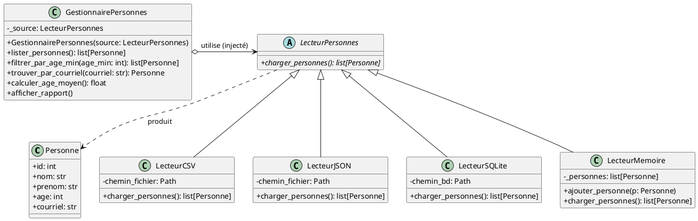
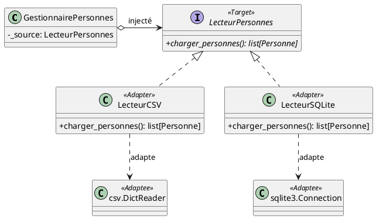

# L'Injection de Dépendances (*Dependency Injection*)

L'**Injection de Dépendances** (*Dependency Injection* ou **DI**) est un patron d'architecture et de conception
fondamental dans le génie logiciel moderne.

Il découle directement du **Principe d'Inversion des Dépendances** (*Dependency Inversion Principle* - **DIP**, le "D"
de **SOLID**) et constitue la forme la plus courante d' **Inversion de Contrôle** (*Inversion of Control* - **IoC**).

---

## 1. Comprendre le problème : Le couplage fort

### Qu'est-ce qu'une dépendance ?

Dans une application orientée objet, une classe dépend d'une autre lorsqu'elle a besoin d'interagir avec elle pour
accomplir son travail.
Par exemple, un service de traitement de données dépend d'un composant d'accès aux fichiers ou à une base de données
pour charger ces données.

### L'anti-patron : L'instanciation interne directe

Considérons une classe `GestionnairePersonnes` qui a pour rôle d'appliquer des règles métier (calcul d'âge moyen,
filtrage, recherche).

Si cette classe crée elle-même l'objet concret dont elle a besoin avec `LecteurSQLite()` ou `LecteurCSV()`, elle devient
**étroitement couplée** (*tightly coupled*) à cette implémentation technique précise :

```python
# ❌ MAUVAISE PRATIQUE : Couplage fort
class GestionnairePersonnes:
    def __init__(self, chemin_bd: str):
        # La classe contrôle et impose son implémentation de stockage !
        self.lecteur = LecteurSQLite(chemin_bd)

    def obtenir_adultes(self):
        personnes = self.lecteur.charger_personnes()
        return [p for p in personnes if p.age >= 18]
```

### Pourquoi cette approche pose-t-elle problème ?

1. **Rigidité (Violation de l'Open/Closed Principle) :** Si demain les données proviennent d'un fichier JSON, d'un
   fichier CSV ou d'un service web REST, il faut ouvrir et modifier la classe `GestionnairePersonnes`.
2. **Difficulté majeure pour les tests unitaires :** Impossible de tester la logique métier de `GestionnairePersonnes`
   de manière isolée sans disposer d'une base de données SQLite réelle sur le disque.
3. **Violation de la responsabilité unique (SRP) :** La classe métier s'occupe à la fois de sa logique (filtrer les
   adultes) et de la configuration technique de ses outils de persistance.

---

## 2. La Solution : Inversion de Contrôle et Injection

### Le principe d'inversion des dépendances (DIP)

Le principe énonce que :
> *Les modules de haut niveau (le domaine métier) ne doivent pas dépendre des modules de bas niveau (les détails
techniques comme les fichiers ou la BD). Tous deux doivent dépendre d'abstractions (interfaces ou classes abstraites).*

### Définition de l'Injection de Dépendances

Au lieu que l'objet aille **créer ou chercher** ses dépendances, on lui **injecte** ses dépendances depuis l'extérieur
(généralement via son constructeur).

> **En résumé :** *"Ne construis pas tes outils, demande qu'on te les donne."*

### Les formes d'injection

1. **Injection par constructeur (*Constructor Injection*) [Recommandée] :** Les dépendances requises sont fournies en
   paramètres de `__init__`. Cela garantit que l'objet est toujours dans un état valide dès son instanciation.
2. **Injection par méthode (*Method Injection*) :** La dépendance est passée en paramètre d'une méthode spécifique qui
   en a ponctuellement besoin.
3. **Injection par propriété / mutateur (*Setter Injection*) :** La dépendance est affectée via un attribut ou une
   propriété après l'instanciation (utile pour des dépendances optionnelles).

---

## 3. Exemple concret pas à pas : Gestion de personnes multi-sources

Construisons un système simple où un `GestionnairePersonnes` manipule des données sans jamais savoir si elles
proviennent d'un fichier **CSV**, d'un fichier **JSON**, d'une base de données **SQLite**, ou d'une liste en mémoire.

### Diagramme de classes UML



---

### Étape 1 : Le Modèle Métier (`Personne`)

Nous représentons une entité personne sous forme de `dataclass` Python :

```python
# personne.py
from dataclasses import dataclass


@dataclass
class Personne:
    """Représentation d'une personne dans le domaine métier."""
    id: int
    nom: str
    prenom: str
    age: int
    courriel: str

    def __str__(self) -> str:
        return f"[{self.id}] {self.prenom} {self.nom}, {self.age} ans ({self.courriel})"
```

---

### Étape 2 : Le Contrat d'Abstraction (`LecteurPersonnes`)

Nous définissons la classe abstraite de base (`ABC`) qui dicte l'interface attendue par notre application :

```python
# lecteurs.py
import csv
import json
import sqlite3
from abc import ABC, abstractmethod
from pathlib import Path
from personne import Personne


class LecteurPersonnes(ABC):
    """
    Interface abstraite définissant la source de données.
    Le service métier dépendra UNIQUEMENT de ce contrat.
    """

    @abstractmethod
    def charger_personnes(self) -> list[Personne]:
        """Charge et retourne la liste des personnes depuis la source."""
        pass
```

---

### Étape 3 : Les Implémentations Concrètes (CSV, JSON, SQLite, Mémoire)

Chaque classe implémente la méthode `charger_personnes()` selon sa spécificité technique :

```python
# lecteurs.py (suite)

class LecteurCSV(LecteurPersonnes):
    """Lecture depuis un fichier CSV (champs séparés par des virgules)."""

    def __init__(self, chemin_fichier: str | Path):
        self.chemin_fichier = Path(chemin_fichier)

    def charger_personnes(self) -> list[Personne]:
        if not self.chemin_fichier.exists():
            return []

        personnes: list[Personne] = []
        with open(self.chemin_fichier, mode="r", encoding="utf-8") as f:
            lecteur = csv.DictReader(f)
            for ligne in lecteur:
                personnes.append(
                    Personne(
                        id=int(ligne["id"]),
                        nom=ligne["nom"],
                        prenom=ligne["prenom"],
                        age=int(ligne["age"]),
                        courriel=ligne["courriel"],
                    )
                )
        return personnes


class LecteurJSON(LecteurPersonnes):
    """Lecture depuis un fichier JSON."""

    def __init__(self, chemin_fichier: str | Path):
        self.chemin_fichier = Path(chemin_fichier)

    def charger_personnes(self) -> list[Personne]:
        if not self.chemin_fichier.exists():
            return []

        with open(self.chemin_fichier, mode="r", encoding="utf-8") as f:
            donnees = json.load(f)

        return [
            Personne(
                id=int(item["id"]),
                nom=item["nom"],
                prenom=item["prenom"],
                age=int(item["age"]),
                courriel=item["courriel"],
            )
            for item in donnees
        ]


class LecteurSQLite(LecteurPersonnes):
    """Lecture depuis une table dans une base de données SQLite."""

    def __init__(self, chemin_bd: str | Path):
        self.chemin_bd = Path(chemin_bd)

    def charger_personnes(self) -> list[Personne]:
        if not self.chemin_bd.exists():
            return []

        personnes: list[Personne] = []
        with sqlite3.connect(self.chemin_bd) as conn:
            cursor = conn.cursor()
            cursor.execute(
                "SELECT id, nom, prenom, age, courriel FROM personnes ORDER BY id"
            )
            for row in cursor.fetchall():
                personnes.append(
                    Personne(
                        id=row[0],
                        nom=row[1],
                        prenom=row[2],
                        age=row[3],
                        courriel=row[4],
                    )
                )
        return personnes


class LecteurMemoire(LecteurPersonnes):
    """Implémentation en mémoire (idéale pour les tests unitaires / bouchons)."""

    def __init__(self, personnes: list[Personne] | None = None):
        self._personnes = list(personnes) if personnes is not None else []

    def ajouter_personne(self, personne: Personne) -> None:
        self._personnes.append(personne)

    def charger_personnes(self) -> list[Personne]:
        return list(self._personnes)
```

---

### Étape 4 : Le Service Métier (`GestionnairePersonnes`)

Observez attentivement la classe ci-dessous : **elle ne contient aucun import de `sqlite3`, de `json` ou de `csv`**.
Elle ignore d'où viennent les données, comment elles ont été stockées ou indexées.

Elle reçoit sa dépendance via son constructeur `__init__(self, source: LecteurPersonnes)` :

```python
# service.py
from personne import Personne
from lecteurs import LecteurPersonnes


class GestionnairePersonnes:
    """
    Service métier de haut niveau.
    Dépend UNIQUEMENT du contrat abstrait LecteurPersonnes.
    La dépendance concrète lui est INJECTÉE à la création.
    """

    def __init__(self, source: LecteurPersonnes):
        self._source = source

    def lister_personnes(self) -> list[Personne]:
        """Récupère l'ensemble des personnes via la source injectée."""
        return self._source.charger_personnes()

    def filtrer_par_age_min(self, age_min: int) -> list[Personne]:
        """Logique métier : retourne les personnes ayant au moins l'âge spécifié."""
        return [p for p in self.lister_personnes() if p.age >= age_min]

    def trouver_par_courriel(self, courriel: str) -> Personne | None:
        """Logique métier : recherche une personne par son adresse courriel."""
        for p in self.lister_personnes():
            if p.courriel.lower() == courriel.lower():
                return p
        return None

    def calculer_age_moyen(self) -> float:
        """Logique métier : calcule l'âge moyen du groupe."""
        personnes = self.lister_personnes()
        if not personnes:
            return 0.0
        return sum(p.age for p in personnes) / len(personnes)

    def afficher_rapport(self) -> None:
        """Affiche un résumé console des personnes et statistiques."""
        personnes = self.lister_personnes()
        nom_source = self._source.__class__.__name__
        print(f"=== Rapport des personnes (Source : {nom_source}) ===")
        print(f"Total personnes : {len(personnes)}")
        for p in personnes:
            print(f"  - {p}")
        if personnes:
            print(f"Âge moyen : {self.calculer_age_moyen():.1f} ans")
        print()
```

---

### Étape 5 : Assemblage et Exécution Console

À la racine de l'application (le point d'entrée ou *Composition Root*), nous choisissons quelle source instancier et
nous l'injectons dans le `GestionnairePersonnes` :

```python
# main.py
from pathlib import Path
from personne import Personne
from lecteurs import (
    LecteurCSV,
    LecteurJSON,
    LecteurSQLite,
    LecteurMemoire,
)
from service import GestionnairePersonnes


def main() -> None:
    dossier = Path(__file__).parent

    # 1. Injection de la source CSV
    source_csv = LecteurCSV(dossier / "personnes.csv")
    gestionnaire_csv = GestionnairePersonnes(source=source_csv)
    gestionnaire_csv.afficher_rapport()

    # 2. Injection de la source JSON
    source_json = LecteurJSON(dossier / "personnes.json")
    gestionnaire_json = GestionnairePersonnes(source=source_json)
    gestionnaire_json.afficher_rapport()

    # 3. Injection de la source SQLite
    source_sqlite = LecteurSQLite(dossier / "personnes.db")
    gestionnaire_sqlite = GestionnairePersonnes(source=source_sqlite)
    gestionnaire_sqlite.afficher_rapport()

    # 4. Traitement métier (identique quelle que soit la source)
    print("=== Filtrage des personnes de 30 ans et plus (Source SQLite) ===")
    for p in gestionnaire_sqlite.filtrer_par_age_min(30):
        print(f"  * {p.prenom} {p.nom} ({p.age} ans)")


if __name__ == "__main__":
    main()
```

#### Sortie console obtenue :

```text
=== Rapport des personnes (Source : LecteurCSV) ===
Total personnes : 4
  - [1] Alice Tremblay, 28 ans (alice.tremblay@exemple.qc.ca)
  - [2] Bob Gagnon, 34 ans (bob.gagnon@exemple.qc.ca)
  - [3] Charlie Roy, 22 ans (charlie.roy@exemple.qc.ca)
  - [4] Diane Bouchard, 45 ans (diane.bouchard@exemple.qc.ca)
Âge moyen : 32.2 ans

=== Rapport des personnes (Source : LecteurJSON) ===
Total personnes : 4
  - [1] Alice Tremblay, 28 ans (alice.tremblay@exemple.qc.ca)
  - [2] Bob Gagnon, 34 ans (bob.gagnon@exemple.qc.ca)
  - [3] Charlie Roy, 22 ans (charlie.roy@exemple.qc.ca)
  - [4] Diane Bouchard, 45 ans (diane.bouchard@exemple.qc.ca)
Âge moyen : 32.2 ans

=== Rapport des personnes (Source : LecteurSQLite) ===
Total personnes : 4
  - [1] Alice Tremblay, 28 ans (alice.tremblay@exemple.qc.ca)
  - [2] Bob Gagnon, 34 ans (bob.gagnon@exemple.qc.ca)
  - [3] Charlie Roy, 22 ans (charlie.roy@exemple.qc.ca)
  - [4] Diane Bouchard, 45 ans (diane.bouchard@exemple.qc.ca)
Âge moyen : 32.2 ans

=== Filtrage des personnes de 30 ans et plus (Source SQLite) ===
  * Bob Gagnon (34 ans)
  * Diane Bouchard (45 ans)
```

---

## 4. Le Grand Bénéfice : Testabilité Maximale (Mocks & Fakes)

L'un des avantages les plus décisifs de l'injection de dépendances est la simplicité absolue avec laquelle on peut
rédiger des **tests unitaires fiables, rapides et déterministes**.

Sans injection, tester `GestionnairePersonnes` nécessiterait de créer une vraie base de données SQLite sur le disque,
d'insérer des lignes avant chaque test, puis de nettoyer la base après.

Avec l'injection, il suffit de lui injecter une source factice en mémoire (`LecteurMemoire`) :

```python
# test_service.py
import pytest
from personne import Personne
from lecteurs import LecteurMemoire
from service import GestionnairePersonnes


def test_calcul_age_moyen_et_filtrage():
    # 1. On prépare des données contrôlées en mémoire (aucun fichier, aucune BD)
    mock_source = LecteurMemoire([
        Personne(1, "TestNom1", "Alice", 20, "alice@test.com"),
        Personne(2, "TestNom2", "Bob", 40, "bob@test.com"),
        Personne(3, "TestNom3", "Charlie", 60, "charlie@test.com"),
    ])

    # 2. On injecte le bouchon dans notre service métier
    service = GestionnairePersonnes(source=mock_source)

    # 3. Assertions sur la logique pure
    assert len(service.lister_personnes()) == 3
    assert service.calculer_age_moyen() == 40.0
    assert len(service.filtrer_par_age_min(35)) == 2
    assert service.trouver_par_courriel("bob@test.com") is not None
    assert service.trouver_par_courriel("inconnu@test.com") is None
```

Les tests s'exécutent en quelques millisecondes, sans effet de bord sur le système de fichiers, et peuvent être lancés
en parallèle sans risque de collision.

---

## 5. Connexion avec les patrons structuraux : Les lecteurs comme Adaptateurs (*Adapters*)

Il est intéressant de constater comment l' **Injection de Dépendances** s'articule naturellement avec d'autres patrons
de conception, en particulier le patron structural **Adaptateur (*Adapter*)** :

- **Le problème d'incompatibilité :** Le module standard `csv.DictReader`, la fonction `json.load()` et le pilote
  `sqlite3.connect()` possèdent des APIs, des signatures de méthodes et des modes de fonctionnement totalement
  hétérogènes.
- **Le rôle d'adaptateur :** Les classes `LecteurCSV`, `LecteurJSON` et `LecteurSQLite` agissent précisément comme des
  **Adaptateurs** : elles enveloppent ces bibliothèques techniques disparates et traduisent leurs données vers le
  contrat cible unique et standardisé `LecteurPersonnes` attendu par notre application.
- **La synergie avec l'injection :** Le patron *Adaptateur* normalise l'accès aux différentes sources, tandis que l'
  *Injection de Dépendances* permet de fournir dynamiquement l'adaptateur requis au service métier
  (`GestionnairePersonnes`) sans que ce dernier ne soit couplé à une technologie spécifique.



---

## 6. Synthèse des Bénéfices de l'Injection de Dépendances

| Bénéfice                                | Explication concrète                                                                                                                  |
|:----------------------------------------|:--------------------------------------------------------------------------------------------------------------------------------------|
| **Couplage faible (*Loose Coupling*)**  | La couche métier ne connaît aucune des technologies de stockage sous-jacentes.                                                        |
| **Testabilité (*Testability*)**         | Remplacement immédiat des dépendances lourdes (BD, réseau, API) par des fakes ou mocks légers.                                        |
| **Extensibilité (Principe OCP)**        | Pour supporter une source XML ou API GraphQL, on ajoute un `LecteurGraphQL(LecteurPersonnes)` sans toucher à `GestionnairePersonnes`. |
| **Séparation des préoccupations (SRP)** | Le service gère la logique métier ; la couche d'accès aux données gère la technique ; le point d'entrée configure l'assemblage.       |
| **Synergie des patrons**                | Les adaptateurs techniques (fichiers, bases de données, services tiers) s'injectent de manière transparente et interchangeable.       |

---

!!! info "Exemple complet de code"
Le code source complet prêt à être exécuté (avec les fichiers de test et générateurs de données) est disponible dans le
fichier [`docs/src/section6/injection/main.py`](../src/section6/injection/main.py).
