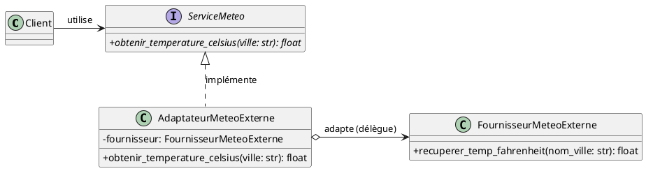
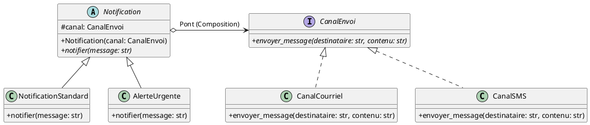
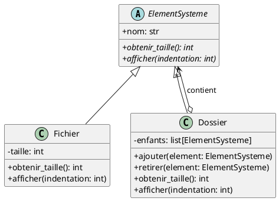
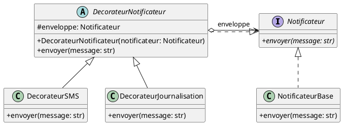
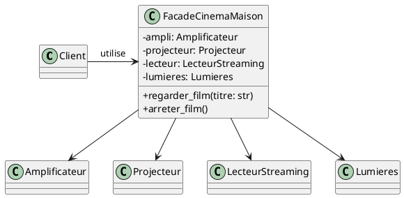
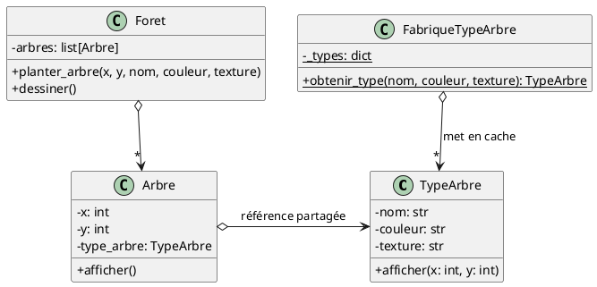

# Patrons de Conception : Structuraux

Les **patrons de conception structuraux** (*Structural Design Patterns*) s'intéressent à la composition des classes et
des objets pour former des structures plus complexes, modulaires et extensibles.

Plutôt que d'avoir recours à un héritage rigide ou à des couplages forts, ils privilégient la **composition d'objets**
pour assembler de nouvelles fonctionnalités tout en maintenant le code souple et facile à faire évoluer.

---

## Vue d'ensemble des patrons structuraux

| Patron                         | Rôle principal                                                                                                |
|:-------------------------------|:--------------------------------------------------------------------------------------------------------------|
| **Adaptateur (*Adapter*)**     | Convertit une interface incompatible vers une interface attendue par le client.                               |
| **Pont (*Bridge*)**            | Sépare une abstraction de son implémentation pour les faire évoluer indépendamment.                           |
| **Composite**                  | Organise des objets en arborescence ("tout-partie") pour traiter objets uniques et groupes de façon uniforme. |
| **Décorateur (*Decorator*)**   | Attache dynamiquement de nouvelles responsabilités à un objet sans modifier sa classe.                        |
| **Façade (*Facade*)**          | Fournit une interface simplifiée pour masquer la complexité d'un sous-système.                                |
| **Poids-Mouche (*Flyweight*)** | Partage l'état commun entre de nombreux objets pour optimiser l'utilisation de la mémoire.                    |
| **Proxy (*Mandataire*)**       | Contrôle ou enrichit l'accès à un objet (chargement différé, sécurité, cache, réseau).                        |

---

## 1. Adaptateur (*Adapter*, *Wrapper*)

### Intention

Convertir l'interface d'une classe existante vers une autre interface attendue par le client. L'adaptateur permet à des
classes de collaborer alors qu'elles auraient été incompatibles en raison d'interfaces divergentes.

### Mise en contexte

Dans le développement logiciel, on doit fréquemment intégrer des bibliothèques tierces, des services externes ou du code
hérité (*legacy*). Modifier directement ces classes est souvent impossible (code fermé) ou indésirable (violation du
principe Open/Closed).

L'adaptateur agit comme un traducteur ou un intermédiaire : il enveloppe l'objet incompatible (*l'adapté*) et expose
l'interface standard exigée par notre application (*la cible*).

!!! info "Lien avec l'Injection de Dépendances"
    Les adaptateurs sont fréquemment utilisés de pair avec l' **Injection de Dépendances** : on injecte l'adaptateur dans
    nos services métier pour masquer les détails techniques d'une bibliothèque tierce.
    Par exemple, les classes `LecteurCSV`, `LecteurJSON` et `LecteurSQLite` vues dans
    le [chapitre sur l'injection de dépendances](05_injection_dependance.md) sont des adaptateurs qui traduisent les
    modules standard de Python vers l'interface `LecteurPersonnes`.

### Diagramme UML



### Exemple en Python

Supposons que notre système météo attend une méthode `obtenir_temperature_celsius(ville: str)`, mais qu'une bibliothèque
externe nous fournit une classe avec une méthode en Fahrenheit `recuperer_temp_fahrenheit(nom_ville: str)` :

```python
from abc import ABC, abstractmethod


# 1. Interface cible attendue par notre application
class ServiceMeteo(ABC):
    @abstractmethod
    def obtenir_temperature_celsius(self, ville: str) -> float:
        """Retourne la température en degrés Celsius."""
        pass


# 2. Classe existante / tierce incompatible (L'Adapté)
class FournisseurMeteoExterne:
    """Bibliothèque tierce que nous ne pouvons pas modifier."""

    def recuperer_temp_fahrenheit(self, nom_ville: str) -> float:
        # Simulation d'un retour d'API externe en °F
        donnees = {"Montreal": 68.0, "Quebec": 62.6, "Paris": 77.0}
        return donnees.get(nom_ville, 32.0)


# 3. L'Adaptateur
class AdaptateurMeteoExterne(ServiceMeteo):
    """Enveloppe le fournisseur externe pour respecter le contrat ServiceMeteo."""

    def __init__(self, fournisseur: FournisseurMeteoExterne):
        self._fournisseur = fournisseur

    def obtenir_temperature_celsius(self, ville: str) -> float:
        # Récupération en °F via l'adapté
        temp_f = self._fournisseur.recuperer_temp_fahrenheit(ville)
        # Conversion mathématique vers °C
        temp_c = (temp_f - 32.0) * 5.0 / 9.0
        return round(temp_c, 1)


# 4. Utilisation par le code client
if __name__ == "__main__":
    service_externe = FournisseurMeteoExterne()
    meteo: ServiceMeteo = AdaptateurMeteoExterne(service_externe)

    ville = "Montreal"
    print(f"Température à {ville} : {meteo.obtenir_temperature_celsius(ville)} °C")
    # Sortie : Température à Montreal : 20.0 °C
```

---

## 2. Pont (*Bridge*)

### Intention

Découpler une abstraction de son implémentation de manière à ce que les deux puissent varier indépendamment l'une de
l'autre.

### Mise en contexte

Lorsque nous avons deux dimensions de variation orthogonales (par exemple, des types de notifications et des canaux
d'envoi), l'héritage classique mène rapidement à une **explosion combinatoire** :

- $N$ types de notifications $\times$ $M$ canaux d'envoi = $N \times M$ classes (`NotificationUrgenteCourriel`,
  `NotificationUrgenteSMS`, `NotificationStandardCourriel`, etc.).

Le patron **Pont** résout ce problème en remplaçant l'héritage par la composition : l'abstraction contient une référence
vers une interface d'implémentation. On passe alors de $N \times M$ classes à seulement $N + M$ classes.

### Diagramme UML



### Exemple en Python

```python
from abc import ABC, abstractmethod


# --- Dimension Implémentation : Canaux d'envoi ---
class CanalEnvoi(ABC):
    @abstractmethod
    def envoyer_message(self, destinataire: str, contenu: str) -> None:
        pass


class CanalCourriel(CanalEnvoi):
    def envoyer_message(self, destinataire: str, contenu: str) -> None:
        print(f"[Courriel à {destinataire}] : {contenu}")


class CanalSMS(CanalEnvoi):
    def envoyer_message(self, destinataire: str, contenu: str) -> None:
        print(f"[SMS au {destinataire}] : {contenu}")


# --- Dimension Abstraction : Types de Notifications ---
class Notification(ABC):
    def __init__(self, canal: CanalEnvoi):
        # Le "Pont" est cette référence vers l'implémentation
        self._canal = canal

    @abstractmethod
    def diffuser(self, destinataire: str, texte: str) -> None:
        pass


class NotificationStandard(Notification):
    def diffuser(self, destinataire: str, texte: str) -> None:
        self._canal.envoyer_message(destinataire, f"Info : {texte}")


class AlerteUrgente(Notification):
    def diffuser(self, destinataire: str, texte: str) -> None:
        message_urgent = f"🚨 URGENT : {texte.upper()} 🚨"
        self._canal.envoyer_message(destinataire, message_urgent)


# --- Utilisation ---
if __name__ == "__main__":
    canal_mail = CanalCourriel()
    canal_sms = CanalSMS()

    # On peut combiner n'importe quelle notification avec n'importe quel canal :
    notif_info = NotificationStandard(canal_mail)
    notif_info.diffuser("etudiant@college.qc.ca", "Le cours commence à 9h.")

    notif_alerte = AlerteUrgente(canal_sms)
    notif_alerte.diffuser("514-555-0199", "Tempête de neige : collège fermé !")
```

---

## 3. Composite

### Intention

Composer des objets dans des structures arborescentes pour représenter des hiérarchies "tout-partie". Le patron
Composite permet aux clients de traiter les objets individuels (*feuilles*) et les groupes d'objets (*composites*) de
manière totalement uniforme.

### Mise en contexte

Le cas d'utilisation le plus classique est le **système de fichiers** :

- Un fichier est un élément individuel sans enfants (une feuille).
- Un dossier est un élément qui contient d'autres dossiers et fichiers (un composite).
- Un client veut pouvoir calculer la taille totale ou afficher l'arborescence sans vérifier manuellement avec des
  `if isinstance(element, Dossier)` à chaque nœud.

### Diagramme UML



### Exemple en Python

```python
from abc import ABC, abstractmethod


class ElementSysteme(ABC):
    """Interface commune pour les feuilles (Fichier) et les composites (Dossier)."""

    def __init__(self, nom: str):
        self.nom = nom

    @abstractmethod
    def obtenir_taille(self) -> int:
        """Retourne la taille en kilo-octets (Ko)."""
        pass

    @abstractmethod
    def afficher(self, indentation: int = 0) -> None:
        """Affiche la structure hiérarchique."""
        pass


class Fichier(ElementSysteme):
    """Feuille : objet terminal sans enfants."""

    def __init__(self, nom: str, taille: int):
        super().__init__(nom)
        self._taille = taille

    def obtenir_taille(self) -> int:
        return self._taille

    def afficher(self, indentation: int = 0) -> None:
        espaces = "  " * indentation
        print(f"{espaces}- 📄 {self.nom} ({self._taille} Ko)")


class Dossier(ElementSysteme):
    """Composite : contient des éléments (feuilles ou d'autres dossiers)."""

    def __init__(self, nom: str):
        super().__init__(nom)
        self._enfants: list[ElementSysteme] = []

    def ajouter(self, element: ElementSysteme) -> None:
        self._enfants.append(element)

    def retirer(self, element: ElementSysteme) -> None:
        self._enfants.remove(element)

    def obtenir_taille(self) -> int:
        # Récursion polymorphique : somme des tailles des enfants
        return sum(enfant.obtenir_taille() for enfant in self._enfants)

    def afficher(self, indentation: int = 0) -> None:
        espaces = "  " * indentation
        print(f"{espaces}+ 📁 {self.nom}/ ({self.obtenir_taille()} Ko total)")
        for enfant in self._enfants:
            enfant.afficher(indentation + 1)


# --- Utilisation ---
if __name__ == "__main__":
    racine = Dossier("projet")
    src = Dossier("src")
    docs = Dossier("docs")

    f1 = Fichier("main.py", 12)
    f2 = Fichier("utils.py", 8)
    f3 = Fichier("readme.md", 4)
    f4 = Fichier("licence.txt", 2)

    src.ajouter(f1)
    src.ajouter(f2)
    docs.ajouter(f3)

    racine.ajouter(src)
    racine.ajouter(docs)
    racine.ajouter(f4)

    # Traitement uniforme sans se soucier du type de composant
    racine.afficher()
    print(f"\nTaille totale du projet : {racine.obtenir_taille()} Ko")
```

---

## 4. Décorateur (*Decorator*, *Wrapper*)

### Intention

Attacher dynamiquement des responsabilités additionnelles à un objet sans modifier son code source ni recourir à
l'héritage statique. Les décorateurs offrent une alternative souple à la sous-classification pour étendre les
fonctionnalités.

### Distinction importante en Python

Il convient de bien distinguer deux notions :

1. **Le patron de conception GoF Décorateur** : Une classe d'emballage (*wrapper*) qui implémente la même interface que
   l'objet qu'elle contient et délègue ses appels en ajoutant un comportement avant ou après.
2. **La syntaxe de décorateur Python (`@decorateur`)** : Un sucre syntaxique du langage appliqué aux fonctions et aux
   classes (ex: `@property`, `@dataclass`, ou `@app.route` dans Flask/FastAPI). Bien qu'inspirée de la même idée
   d'enrichissement, la syntaxe `@` repose sur des fonctions d'ordre supérieur (*closures*), alors que le patron GoF
   repose sur le polymorphisme d'objets.

### Diagramme UML (Patron GoF)



### Exemple en Python (Patron GoF)

```python
from abc import ABC, abstractmethod


# 1. Interface commune
class Notificateur(ABC):
    @abstractmethod
    def envoyer(self, message: str) -> None:
        pass


# 2. Composant de base concret
class NotificateurCourriel(Notificateur):
    def __init__(self, courriel: str):
        self.courriel = courriel

    def envoyer(self, message: str) -> None:
        print(f"📧 Envoi courriel à {self.courriel} : {message}")


# 3. Classe de base abstraite du décorateur
class DecorateurNotificateur(Notificateur):
    def __init__(self, notificateur: Notificateur):
        self._enveloppe = notificateur

    def envoyer(self, message: str) -> None:
        # Délégation par défaut à l'objet enveloppé
        self._enveloppe.envoyer(message)


# 4. Décorateurs concrets
class DecorateurSMS(DecorateurNotificateur):
    def __init__(self, notificateur: Notificateur, numero_tel: str):
        super().__init__(notificateur)
        self.numero_tel = numero_tel

    def envoyer(self, message: str) -> None:
        super().envoyer(message)
        # Responsabilité additionnelle
        print(f"📱 Envoi SMS au {self.numero_tel} : {message}")


class DecorateurJournalisation(DecorateurNotificateur):
    def envoyer(self, message: str) -> None:
        super().envoyer(message)
        # Responsabilité additionnelle : log d'audit
        print(f"📝 [LOG AUDIT] Notification transmise avec succès : '{message}'")


# --- Utilisation dynamique et composition en couches ---
if __name__ == "__main__":
    # Notification de base
    notif = NotificateurCourriel("admin@entreprise.com")

    # On décore dynamiquement avec l'envoi de SMS ET la journalisation
    notif_complete = DecorateurJournalisation(
        DecorateurSMS(notif, "514-555-4321")
    )

    print("--- Envoi via la chaîne de décorateurs ---")
    notif_complete.envoyer("Alerte panne de serveur")
```

---

## 5. Façade (*Facade*)

### Intention

Fournir une interface unifiée et simplifiée de haut niveau pour masquer la complexité d'un sous-système composé de
multiples classes interdépendantes.

### Mise en contexte

Un sous-système (comme un moteur de rendu vidéo, une bibliothèque audio ou un système d'authentification et de paiement)
peut comporter des dizaines de classes spécialisées avec des ordres d'initialisation stricts.

La façade offre un point d'entrée unique et simple pour les cas d'usage courants du client, tout en laissant les classes
internes accessibles pour les utilisateurs avancés ayant besoin de réglages pointus.

### Diagramme UML



### Exemple en Python

```python
# Classes du sous-système complexe
class Amplificateur:
    def allumer(self) -> None:
        print("🔊 Amplificateur allumé (Volume : 50%, Son surround)")

    def eteindre(self) -> None:
        print("🔊 Amplificateur éteint")


class Projecteur:
    def allumer(self) -> None:
        print("📽️ Projecteur allumé (Mode Cinéma 4K)")

    def eteindre(self) -> None:
        print("📽️ Projecteur éteint")


class LecteurStreaming:
    def charger(self, film: str) -> None:
        print(f"🎬 Film '{film}' chargé et prêt à la lecture")

    def stopper(self) -> None:
        print("🎬 Lecture arrêtée")


class Lumieres:
    def tamiser(self, niveau: int) -> None:
        print(f"💡 Lumières tamisées à {niveau}%")

    def allumer(self) -> None:
        print("💡 Lumières allumées à 100%")


# La Façade
class FacadeCinemaMaison:
    """Fournit une interface à 1 bouton pour toute la séquence complexe."""

    def __init__(self):
        self._ampli = Amplificateur()
        self._projecteur = Projecteur()
        self._lecteur = LecteurStreaming()
        self._lumieres = Lumieres()

    def regarder_film(self, titre: str) -> None:
        print(f"\n--- Préparation de la séance : {titre} ---")
        self._lumieres.tamiser(15)
        self._projecteur.allumer()
        self._ampli.allumer()
        self._lecteur.charger(titre)
        print("🍿 Bon film !")

    def arreter_film(self) -> None:
        print("\n--- Extinction du cinéma maison ---")
        self._lecteur.stopper()
        self._ampli.eteindre()
        self._projecteur.eteindre()
        self._lumieres.allumer()


# Code client : simple et propre
if __name__ == "__main__":
    cinema = FacadeCinemaMaison()
    cinema.regarder_film("Inception")
    cinema.arreter_film()
```

---

## 6. Poids-Mouche (*Flyweight*)

### Intention

Réduire la consommation de mémoire vive en partageant efficacement un grand nombre d'objets similaires au lieu de
dupliquer leurs données invariantes.

### Mise en contexte et concepts

Dans des applications manipulant des dizaines de milliers d'objets (jeux vidéo avec des particules, arbres dans une
forêt, caractères dans un traitement de texte), instancier un objet complet pour chaque élément provoquerait une
surcharge mémoire majeure.

Le patron divise l'état d'un objet en deux parties :

- **État intrinsèque (*Intrinsic State*)** : Les données constantes, immuables et volumineuses, partagées par toutes les
  instances identiques (ex: texture, maillage 3D, espèce d'un arbre).
- **État extrinsèque (*Extrinsic State*)** : Les données variables et spécifiques à chaque occurrence (ex:
  coordonnées $(x, y)$, niveau de vie, taille individuelle), transmises en paramètre lors de l'appel des méthodes.

### Diagramme UML



### Exemple en Python

```python
class TypeArbre:
    """État intrinsèque : partagé entre des milliers d'arbres identiques."""

    def __init__(self, nom: str, couleur: str, texture: str):
        self.nom = nom
        self.couleur = couleur
        self.texture = texture

    def afficher(self, x: int, y: int) -> None:
        print(f"🌲 Arbre '{self.nom}' ({self.couleur}, texture={self.texture}) rendu à ({x}, {y})")


class FabriqueTypeArbre:
    """Gestionnaire de cache garantissant l'unicité des types intrinsèques."""

    _types: dict[tuple[str, str, str], TypeArbre] = {}

    @classmethod
    def obtenir_type(cls, nom: str, couleur: str, texture: str) -> TypeArbre:
        cle = (nom, couleur, texture)
        if cle not in cls._types:
            cls._types[cle] = TypeArbre(nom, couleur, texture)
            print(f"📦 [Cache] Nouveau TypeArbre alloué en mémoire : {nom}")
        return cls._types[cle]


class Arbre:
    """État extrinsèque : coordonnées uniques pour chaque arbre."""

    def __init__(self, x: int, y: int, type_arbre: TypeArbre):
        self.x = x
        self.y = y
        self.type_arbre = type_arbre

    def afficher(self) -> None:
        self.type_arbre.afficher(self.x, self.y)


# --- Simulation d'une forêt ---
if __name__ == "__main__":
    arbres: list[Arbre] = []

    # On plante 10 000 arbres de 2 espèces différentes
    for i in range(5000):
        type_chene = FabriqueTypeArbre.obtenir_type("Chêne", "Vert foncé", "ecorce_chene.png")
        arbres.append(Arbre(x=i * 2, y=i * 3, type_arbre=type_chene))

    for i in range(5000):
        type_pin = FabriqueTypeArbre.obtenir_type("Pin", "Vert forêt", "ecorce_pin.png")
        arbres.append(Arbre(x=i * 4, y=i * 5, type_arbre=type_pin))

    print(f"\nTotal arbres plantés : {len(arbres)}")
    print(f"Nombre réel d'objets TypeArbre en mémoire : {len(FabriqueTypeArbre._types)}")
    # Seuls 2 objets TypeArbre existent en mémoire pour 10 000 arbres !
```

---

## 7. Proxy (*Mandataire*, *Substitut*)

### Intention

Fournir un mandataire ou un substitut (*surrogate*) pour un autre objet afin de contrôler et d'intercepter les accès à
cet objet.

### Principales variantes de Proxy

1. **Proxy virtuel (*Virtual Proxy*)** : Diffère l'instanciation ou le chargement d'un objet lourd (*lazy loading*)
   jusqu'à ce qu'il soit réellement utilisé.
2. **Proxy de protection (*Protection Proxy*)** : Vérifie les autorisations et les rôles de l'utilisateur avant
   d'autoriser l'accès aux méthodes sensibles.
3. **Proxy distant (*Remote Proxy*)** : Représente localement un objet situé sur un autre serveur ou processus distant
   (appels RPC / réseau).
4. **Proxy de mise en cache (*Caching Proxy*)** : Conserve les résultats d'opérations coûteuses pour éviter des
   recalculs.

### Exemple en Python : Proxy Virtuel (Chargement différé d'une image)

```python
from abc import ABC, abstractmethod
import time


class Image(ABC):
    @abstractmethod
    def afficher(self) -> None:
        pass


class ImageHauteResolution(Image):
    """Objet réel lourd : son chargement prend du temps et de la RAM."""

    def __init__(self, chemin_fichier: str):
        self.chemin_fichier = chemin_fichier
        self._charger_depuis_disque()

    def _charger_depuis_disque(self) -> None:
        print(f"⏳ Chargement lourd du fichier '{self.chemin_fichier}'...")
        time.sleep(0.5)  # Simulation du coût d'I/O
        print(f"✅ Image '{self.chemin_fichier}' chargée en mémoire vive.")

    def afficher(self) -> None:
        print(f"🖼️ Affichage à l'écran de '{self.chemin_fichier}'")


class ProxyImage(Image):
    """Proxy virtuel : ne charge l'image réelle que si 'afficher()' est appelé."""

    def __init__(self, chemin_fichier: str):
        self.chemin_fichier = chemin_fichier
        self._image_reelle: ImageHauteResolution | None = None

    def afficher(self) -> None:
        # Initialisation paresseuse (Lazy Loading)
        if self._image_reelle is None:
            self._image_reelle = ImageHauteResolution(self.chemin_fichier)
        self._image_reelle.afficher()


# --- Utilisation ---
if __name__ == "__main__":
    print("1. Création des proxies dans la galerie (instantané) :")
    photo1 = ProxyImage("photo_4k_vacances.raw")
    photo2 = ProxyImage("photo_4k_mariage.raw")

    print("\n2. L'utilisateur clique sur la première photo seulement :")
    photo1.afficher()

    print("\n3. L'utilisateur reclique sur la première photo (déjà chargée) :")
    photo1.afficher()
```

!!! tip "Cas concret avancé : Le patron Proxy dans Qt/PySide6"
Dans les interfaces graphiques Qt, le patron Proxy est abondamment utilisé via `QSortFilterProxyModel` pour intercepter
les requêtes entre une vue (`QTableView`) et un modèle de données (`QAbstractTableModel`) afin de réaliser des tris et
des filtrages dynamiques sans altérer les données sous-jacentes.

    Consultez le document dédié : [Architecture de Données : Le Modèle Proxy dans Qt/PySide6](proxy_qt.md).

---

## Tableau récapitulatif des Patrons Structuraux

| Patron           | Quand l'utiliser ?                                                                   | Bénéfice clé                                                               |
|:-----------------|:-------------------------------------------------------------------------------------|:---------------------------------------------------------------------------|
| **Adaptateur**   | Une classe existante offre les bonnes données mais avec une interface incompatible.  | Réutilisation de bibliothèques tierces sans modifier leur code.            |
| **Pont**         | Vous avez plusieurs variantes d'abstractions et plusieurs moteurs d'implémentation.  | Évite l'explosion combinatoire de classes ($N+M$ au lieu de $N \times M$). |
| **Composite**    | Vous modélisez des structures hiérarchiques de type arbre (fichiers/dossiers).       | Traitement uniforme des éléments individuels et des groupes.               |
| **Décorateur**   | Vous devez ajouter des comportements à la volée de manière combinable.               | Remplacement souple de l'héritage statique par l'emballage dynamique.      |
| **Façade**       | Vous devez interagir avec un sous-système complexe via des actions simples.          | Réduction du couplage et interface épurée pour les clients.                |
| **Poids-Mouche** | Votre application manipule un très grand volume d'objets similaires.                 | Réduction drastique de la consommation de mémoire vive.                    |
| **Proxy**        | Vous souhaitez contrôler, différer, sécuriser ou mettre en cache l'accès à un objet. | Contrôle transparent sans modifier la classe de l'objet cible.             |
