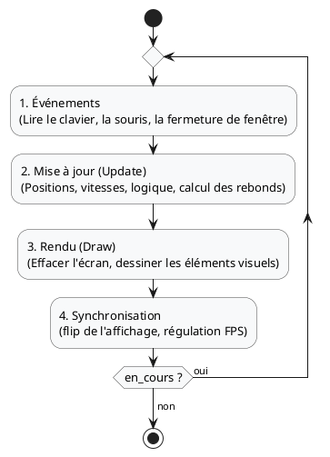

# **Introduction à Pygame : Les bases du jeu 2D**

Pygame est une bibliothèque Python incontournable pour s'initier au développement de jeux vidéo 2D et d'interfaces
interactives temps réel. Elle offre un accès direct et pragmatique à la gestion de l'affichage graphique, des
périphériques d'entrée (clavier, souris) et de l'audio.

Ce chapitre pose les fondations indispensables avant d'aborder une architecture orientée objet plus avancée.

---

## **1. Installation**

Dans le cadre de votre environnement de projet géré avec `uv`, l'ajout de Pygame se fait simplement via la commande :

```bash
uv add pygame
```

*Vérification rapide dans votre terminal ou script Python :*

```python
import pygame

print(f"Pygame version : {pygame.__version__}")
```

---

## **2. Le concept central : La boucle de jeu (*Game Loop*)**

Contrairement aux applications classiques ou aux interfaces pilotées purement par événements passifs, un jeu vidéo
repose sur une **boucle infinie cadencée** qui s'exécute à fréquence régulière (par exemple 60 fois par seconde).

Chaque itération de cette boucle suit invariablement quatre étapes successives :



### Le repère de l'écran en Pygame

En infographie 2D et en Pygame :

- L'origine **$(0, 0)$** se trouve dans le **coin supérieur gauche** de la fenêtre.
- L'axe des **$X$** s'étend de gauche à droite ($0 \rightarrow \text{largeur}$).
- L'axe des **$Y$** s'étend de haut en bas ($0 \rightarrow \text{hauteur}$).

---

## **3. Premier exemple : Contrôler un carré au clavier**

Dans ce premier exemple entièrement autonome, nous créons une fenêtre graphique et permettons à l'utilisateur de
déplacer un carré bleu avec les touches fléchées du clavier.

```python title="docs/src/section7/01_carre_clavier.py"
import sys
import pygame

# 1. Initialisation de Pygame
pygame.init()

# Dimensions de la fenêtre
LARGEUR, HAUTEUR = 800, 600
FENETRE = pygame.display.set_mode((LARGEUR, HAUTEUR))
pygame.display.set_caption("Introduction Pygame - Déplacement au clavier")

# Horloge pour réguler le nombre d'images par seconde (FPS)
horloge = pygame.time.Clock()
FPS = 60

# Couleurs (R, V, B)
COULEUR_FOND = (30, 30, 30)
COULEUR_CARRE = (70, 130, 180)  # Bleu acier

# Propriétés du carré du joueur
taille_carre = 50
x = (LARGEUR - taille_carre) // 2
y = (HAUTEUR - taille_carre) // 2
vitesse = 5

# Boucle principale du jeu
en_cours = True
while en_cours:
    # --- 1. Gestion des événements ---
    for evenement in pygame.event.get():
        if evenement.type == pygame.QUIT:
            en_cours = False

    # --- 2. Mise à jour de l'état (déplacement) ---
    touches = pygame.key.get_pressed()
    if touches[pygame.K_LEFT]:
        x -= vitesse
    if touches[pygame.K_RIGHT]:
        x += vitesse
    if touches[pygame.K_UP]:
        y -= vitesse
    if touches[pygame.K_DOWN]:
        y += vitesse

    # Garder le carré dans les limites de l'écran
    x = max(0, min(LARGEUR - taille_carre, x))
    y = max(0, min(HAUTEUR - taille_carre, y))

    # --- 3. Dessin / Rendu ---
    FENETRE.fill(COULEUR_FOND)
    pygame.draw.rect(FENETRE, COULEUR_CARRE, (x, y, taille_carre, taille_carre))

    # --- 4. Rafraîchissement de l'affichage et régulation ---
    pygame.display.flip()
    horloge.tick(FPS)

# Fermeture propre de Pygame
pygame.quit()
sys.exit()
```

### Explications détaillées

1. **Initialisation et fenêtre** :
    - `pygame.init()` initialise l'ensemble des modules sous-jacents de Pygame.
    - `pygame.display.set_mode((LARGEUR, HAUTEUR))` réserve la surface d'affichage principale.
    - `pygame.time.Clock()` permet de contrôler le rythme d'exécution de la boucle pour garantir une vitesse homogène
      sur n'importe quel ordinateur grâce à `horloge.tick(FPS)`.

2. **Lecture des touches (`pygame.key.get_pressed()`)** :
    - `pygame.key.get_pressed()` renvoie un tableau contenant l'état instantané (pressée ou relâchée) de chaque touche.
    - Pour un mouvement fluide en maintenant une touche enfoncée, cette approche par scrutation d'état (*polling*) est
      nettement plus efficace et naturelle que d'attendre des événements de touche répétitifs.

3. **Bornage aux limites de la fenêtre** :
    - L'utilisation de `max(0, min(LARGEUR - taille_carre, x))` garantit de manière concise que les coordonnées restent
      strictement dans la zone visible.

4. **Double buffering (`pygame.display.flip()`)** :
    - Tous les dessins sont d'abord effectués sur une mémoire tampon en arrière-plan. `flip()` échange le tampon
      d'affichage avec celui de l'écran visible pour éviter tout scintillement (*flickering*).

---

## **4. Deuxième exemple : Ajout d'un carré autonome au comportement aléatoire**

Pour enrichir la scène, nous ajoutons un second élément visuel (un carré rouge) qui :

- Se déplace de façon autonome avec sa propre vitesse vectorielle $(v_x, v_y)$.
- Rebondit automatiquement sur les quatre bordures de la fenêtre.
- Modifie périodiquement sa direction de manière aléatoire.

```python title="docs/src/section7/02_carre_hasard.py"
import random
import sys
import pygame

# 1. Initialisation de Pygame
pygame.init()

# Dimensions de la fenêtre
LARGEUR, HAUTEUR = 800, 600
FENETRE = pygame.display.set_mode((LARGEUR, HAUTEUR))
pygame.display.set_caption("Pygame - Carré Joueur et Carré Aléatoire Autonome")

# Horloge pour réguler le taux de rafraîchissement
horloge = pygame.time.Clock()
FPS = 60

# Couleurs (R, V, B)
COULEUR_FOND = (30, 30, 30)
COULEUR_JOUEUR = (70, 130, 180)  # Bleu acier
COULEUR_AUTONOME = (220, 80, 80)  # Rouge corail

# --- Propriétés du joueur (contrôlé au clavier) ---
taille_joueur = 50
joueur_x = (LARGEUR - taille_joueur) // 4
joueur_y = (HAUTEUR - taille_joueur) // 2
vitesse_joueur = 5

# --- Propriétés de l'élément autonome (déplacement au hasard) ---
taille_autonome = 40
autonome_x = (LARGEUR - taille_autonome) * 3 // 4
autonome_y = (HAUTEUR - taille_autonome) // 2
vitesse_auto_x = random.choice([-4, -3, 3, 4])
vitesse_auto_y = random.choice([-4, -3, 3, 4])

# Minuteur pour changer la trajectoire aléatoirement de temps en temps
compteur_changement = 0
INTERVALLE_CHANGEMENT = 90  # Environ toutes les 1.5 secondes (à 60 FPS)

# Boucle principale du jeu
en_cours = True
while en_cours:
    # --- 1. Gestion des événements ---
    for evenement in pygame.event.get():
        if evenement.type == pygame.QUIT:
            en_cours = False

    # --- 2. Mise à jour du carré Joueur (clavier) ---
    touches = pygame.key.get_pressed()
    if touches[pygame.K_LEFT]:
        joueur_x -= vitesse_joueur
    if touches[pygame.K_RIGHT]:
        joueur_x += vitesse_joueur
    if touches[pygame.K_UP]:
        joueur_y -= vitesse_joueur
    if touches[pygame.K_DOWN]:
        joueur_y += vitesse_joueur

    # Garder le joueur dans l'écran
    joueur_x = max(0, min(LARGEUR - taille_joueur, joueur_x))
    joueur_y = max(0, min(HAUTEUR - taille_joueur, joueur_y))

    # --- 3. Mise à jour du carré Autonome (hasard et rebonds) ---
    autonome_x += vitesse_auto_x
    autonome_y += vitesse_auto_y

    # Rebond sur les bords horizontaux (gauche / droite)
    if autonome_x <= 0:
        autonome_x = 0
        vitesse_auto_x = abs(vitesse_auto_x)
    elif autonome_x >= LARGEUR - taille_autonome:
        autonome_x = LARGEUR - taille_autonome
        vitesse_auto_x = -abs(vitesse_auto_x)

    # Rebond sur les bords verticaux (haut / bas)
    if autonome_y <= 0:
        autonome_y = 0
        vitesse_auto_y = abs(vitesse_auto_y)
    elif autonome_y >= HAUTEUR - taille_autonome:
        autonome_y = HAUTEUR - taille_autonome
        vitesse_auto_y = -abs(vitesse_auto_y)

    # Changement aléatoire périodique de direction
    compteur_changement += 1
    if compteur_changement >= INTERVALLE_CHANGEMENT:
        compteur_changement = 0
        vitesse_auto_x = random.randint(-5, 5)
        vitesse_auto_y = random.randint(-5, 5)
        # Éviter que le carré ne s'immobilise complètement
        if vitesse_auto_x == 0 and vitesse_auto_y == 0:
            vitesse_auto_x = 3

    # --- 4. Dessin / Rendu ---
    FENETRE.fill(COULEUR_FOND)

    # Dessin du joueur
    pygame.draw.rect(FENETRE, COULEUR_JOUEUR, (joueur_x, joueur_y, taille_joueur, taille_joueur))
    # Dessin du carré autonome
    pygame.draw.rect(FENETRE, COULEUR_AUTONOME, (autonome_x, autonome_y, taille_autonome, taille_autonome))

    # --- 5. Rafraîchissement et régulation ---
    pygame.display.flip()
    horloge.tick(FPS)

# Fermeture propre
pygame.quit()
sys.exit()
```

### Mécanismes clés mis en évidence

1. **Vecteur vitesse et rebond** :
    - Pour simuler un rebond sur un mur vertical, il suffit d'inverser le signe de la vitesse
      horizontale : $v_x \leftarrow -v_x$.
    - Pour un mur horizontal, on inverse le signe de la vitesse verticale : $v_y \leftarrow -v_y$.

2. **Événements temporels non bloquants** :
    - Plutôt que d'utiliser des pauses bloquantes (comme `time.sleep()`, qui gèleraient toute l'application et les
      entrées utilisateur), on incrémente un compteur de trames (`compteur_changement`) à chaque tour de boucle.

---

## **5. Troisième exemple : Détection de collisions et écran *Game Over***

Dans ce troisième exemple, nous franchissons une étape clé vers la création d'un vrai jeu : **détecter l'impact entre
deux entités** et gérer un **changement d'état** (passage en écran de fin de partie *Game Over*).

Lorsqu'une collision survient :

1. Le mouvement des carrés s'arrête (la logique du jeu est gelée).
2. Un message principal **"GAME OVER"** et un sous-titre d'instruction **"Appuyez sur ESC pour quitter"** sont affichés
   au centre de l'écran.
3. L'utilisateur peut appuyer sur la touche **Échap (ESC)** pour fermer proprement la fenêtre.

```python title="docs/src/section7/03_collision.py"
import random
import sys
import pygame

# 1. Initialisation de Pygame et du module de polices
pygame.init()

# Dimensions de la fenêtre
LARGEUR, HAUTEUR = 800, 600
FENETRE = pygame.display.set_mode((LARGEUR, HAUTEUR))
pygame.display.set_caption("Pygame - Détection de collision et Game Over")

# Horloge pour réguler le taux de rafraîchissement
horloge = pygame.time.Clock()
FPS = 60

# Couleurs (R, V, B)
COULEUR_FOND = (30, 30, 30)
COULEUR_JOUEUR = (70, 130, 180)  # Bleu acier
COULEUR_AUTONOME = (220, 80, 80)  # Rouge corail
COULEUR_TEXTE = (255, 255, 255)  # Blanc
COULEUR_GAMEOVER = (230, 50, 50)  # Rouge vif

# Polices pour les messages de fin de partie
police_titre = pygame.font.Font(None, 64)
police_sous_titre = pygame.font.Font(None, 32)

# --- Propriétés du joueur (contrôlé au clavier) ---
taille_joueur = 50
joueur_x = (LARGEUR - taille_joueur) // 4
joueur_y = (HAUTEUR - taille_joueur) // 2
vitesse_joueur = 5

# --- Propriétés du carré autonome ---
taille_autonome = 40
autonome_x = (LARGEUR - taille_autonome) * 3 // 4
autonome_y = (HAUTEUR - taille_autonome) // 2
vitesse_auto_x = random.choice([-4, -3, 3, 4])
vitesse_auto_y = random.choice([-4, -3, 3, 4])

compteur_changement = 0
INTERVALLE_CHANGEMENT = 90

# État du jeu
en_cours = True
partie_terminee = False

# Boucle principale du jeu
while en_cours:
    # --- 1. Gestion des événements ---
    for evenement in pygame.event.get():
        if evenement.type == pygame.QUIT:
            en_cours = False
        elif evenement.type == pygame.KEYDOWN:
            # Quitter avec la touche Échap (ESC)
            if evenement.key == pygame.K_ESCAPE:
                en_cours = False

    # --- 2. Mise à jour de la logique si la partie est active ---
    if not partie_terminee:
        # Déplacement du joueur au clavier
        touches = pygame.key.get_pressed()
        if touches[pygame.K_LEFT]:
            joueur_x -= vitesse_joueur
        if touches[pygame.K_RIGHT]:
            joueur_x += vitesse_joueur
        if touches[pygame.K_UP]:
            joueur_y -= vitesse_joueur
        if touches[pygame.K_DOWN]:
            joueur_y += vitesse_joueur

        # Limites de l'écran pour le joueur
        joueur_x = max(0, min(LARGEUR - taille_joueur, joueur_x))
        joueur_y = max(0, min(HAUTEUR - taille_joueur, joueur_y))

        # Déplacement et rebonds du carré autonome
        autonome_x += vitesse_auto_x
        autonome_y += vitesse_auto_y

        if autonome_x <= 0:
            autonome_x = 0
            vitesse_auto_x = abs(vitesse_auto_x)
        elif autonome_x >= LARGEUR - taille_autonome:
            autonome_x = LARGEUR - taille_autonome
            vitesse_auto_x = -abs(vitesse_auto_x)

        if autonome_y <= 0:
            autonome_y = 0
            vitesse_auto_y = abs(vitesse_auto_y)
        elif autonome_y >= HAUTEUR - taille_autonome:
            autonome_y = HAUTEUR - taille_autonome
            vitesse_auto_y = -abs(vitesse_auto_y)

        # Changement de direction aléatoire périodique
        compteur_changement += 1
        if compteur_changement >= INTERVALLE_CHANGEMENT:
            compteur_changement = 0
            vitesse_auto_x = random.randint(-5, 5)
            vitesse_auto_y = random.randint(-5, 5)
            if vitesse_auto_x == 0 and vitesse_auto_y == 0:
                vitesse_auto_x = 3

        # Détection des collisions avec pygame.Rect
        rect_joueur = pygame.Rect(joueur_x, joueur_y, taille_joueur, taille_joueur)
        rect_autonome = pygame.Rect(autonome_x, autonome_y, taille_autonome, taille_autonome)

        if rect_joueur.colliderect(rect_autonome):
            partie_terminee = True

    # --- 3. Dessin / Rendu ---
    FENETRE.fill(COULEUR_FOND)

    # Dessin des deux carrés
    pygame.draw.rect(FENETRE, COULEUR_JOUEUR, (joueur_x, joueur_y, taille_joueur, taille_joueur))
    pygame.draw.rect(FENETRE, COULEUR_AUTONOME, (autonome_x, autonome_y, taille_autonome, taille_autonome))

    # Affichage de l'écran Game Over si collision
    if partie_terminee:
        # Message principal
        surface_titre = police_titre.render("GAME OVER", True, COULEUR_GAMEOVER)
        rect_titre = surface_titre.get_rect(center=(LARGEUR // 2, HAUTEUR // 2 - 30))
        FENETRE.blit(surface_titre, rect_titre)

        # Message d'instruction
        surface_instruction = police_sous_titre.render("Appuyez sur ESC pour quitter", True, COULEUR_TEXTE)
        rect_instruction = surface_instruction.get_rect(center=(LARGEUR // 2, HAUTEUR // 2 + 30))
        FENETRE.blit(surface_instruction, rect_instruction)

    # --- 4. Rafraîchissement et régulation ---
    pygame.display.flip()
    horloge.tick(FPS)

# Fermeture propre
pygame.quit()
sys.exit()
```

### Mécanismes clés introduits

1. **La détection de collision avec `pygame.Rect` et `colliderect()`** :
    - En 2D, les collisions les plus courantes et rapides à calculer sont basées sur des boîtes rectangulaires alignées
      sur les axes (*AABB* pour *Axis-Aligned Bounding Box*).
    - La classe `pygame.Rect(x, y, largeur, hauteur)` modélise un rectangle géométrique.
    - La méthode `rect1.colliderect(rect2)` renvoie `True` si les deux rectangles se chevauchent, `False` sinon :
      ```python
      if rect_joueur.colliderect(rect_autonome):
          partie_terminee = True
      ```

2. **La gestion de l'état du jeu** :
    - Le booléen `partie_terminee` isole la phase de jeu actif de la phase de fin de partie.
    - Quand `partie_terminee == True`, la mise à jour des positions est sautée : les carrés restent figés là où l'impact
      s'est produit.

3. **Le rendu de texte avec `pygame.font`** :
    - **Création de la police** : `police = pygame.font.Font(None, taille)` charge la police système par défaut de
      Pygame.
    - **Génération de la surface de texte** : `surface_texte = police.render(texte, antialias, couleur)` convertit la
      chaîne en une image (Surface).
    - **Positionnement et centrage** : `rect = surface_texte.get_rect(center=(cx, cy))` calcule facilement la position
      exacte pour centrer le texte.
    - **Affichage sur l'écran** : `FENETRE.blit(surface_texte, rect)` copie la surface du texte sur la surface
      principale de la fenêtre.

4. **Gestion de la touche Échap (`pygame.K_ESCAPE`)** :
    - Dans la boucle d'événements, l'événement `pygame.KEYDOWN` permet de capturer la frappe ponctuelle de
      `pygame.K_ESCAPE` pour quitter l'application.

---

## **6. Pourquoi passer à la Programmation Orientée Objet ?**

L'approche procédurale présentée ci-dessus fonctionne bien pour des scripts courts d'expérimentation. Toutefois,
analysez ce qui se passe si nous voulons ajouter :

- Dix carrés autonomes supplémentaires ;
- Des caractéristiques propres (points de vie, types d'attaques, couleurs distinctes) ;
- La détection de collision entre le joueur et chaque carré ;
- Plusieurs états de jeu (menu principal, partie en cours, pause, game over, tableau des scores).

Dans un style purement procédural, le nombre de variables isolées et la complexité des conditions dans la boucle
principale explosent rapidement :

```python
# Exemple de prolifération ingérable de variables procédurales :
carre1_x, carre1_y, carre1_vx, carre1_vy = ...
carre2_x, carre2_y, carre2_vx, carre2_vy = ...
carre3_x, carre3_y, carre3_vx, carre3_vy = ...
```

### Avantages de l'encapsulation OO

L'Orienté Objet apporte une réponse directe pour maximiser la clarté, l'évolutivité et la maintenabilité du code :

| Aspect                        | Approche Procédurale                              | Approche Orientée Objet                                                         |
|:------------------------------|:--------------------------------------------------|:--------------------------------------------------------------------------------|
| **Organisation**              | Variables globales ou dispersées                  | Regroupement de l'état et des comportements dans une classe                     |
| **Multiplication d'entités**  | Duplication de code ou listes de tuples complexes | Instanciation directe : `[Ennemi() for _ in range(10)]`                         |
| **Évolution du comportement** | Boucle principale encombrée de `if/else`          | Méthodes dédiées : `entite.update()` et `entite.draw(ecran)`                    |
| **Écosystème Pygame**         | Gestion manuelle des surfaces                     | Utilisation des classes natives `pygame.sprite.Sprite` et `pygame.sprite.Group` |

Dans les sections suivantes, nous verrons comment structurer proprement nos entités avec des classes spécialisées et
tirer parti du module `pygame.sprite`.

---

## **7. Résumé des commandes essentielles**

- `pygame.init()` : Initialise les sous-systèmes de Pygame (y compris l'affichage et les polices).
- `pygame.display.set_mode((w, h))` : Crée la fenêtre de rendu.
- `pygame.event.get()` : Récupère la liste des événements survenus depuis la dernière frame.
- `pygame.key.get_pressed()` : Lit l'état en direct de toutes les touches du clavier.
- `pygame.Rect(x, y, w, h)` : Crée un objet rectangle pour le positionnement et les collisions.
- `rect1.colliderect(rect2)` : Teste l'intersection géométrique entre deux rectangles.
- `pygame.font.Font(fichier, taille)` : Charge une police de caractères (ou `None` pour la police par défaut).
- `police.render(texte, antialias, couleur)` : Crée une surface contenant le texte rendu.
- `surface.blit(source, rect_ou_pos)` : Dessine une surface par-dessus une autre surface.
- `surface.fill(couleur)` : Remplit une surface avec une couleur unie.
- `pygame.draw.rect(surface, couleur, rect)` : Dessine un rectangle géométrique.
- `pygame.display.flip()` : Met à jour la totalité de l'écran affiché.
- `horloge.tick(FPS)` : Bloque temporairement l'exécution pour caler le framerate sur la cible définie.
