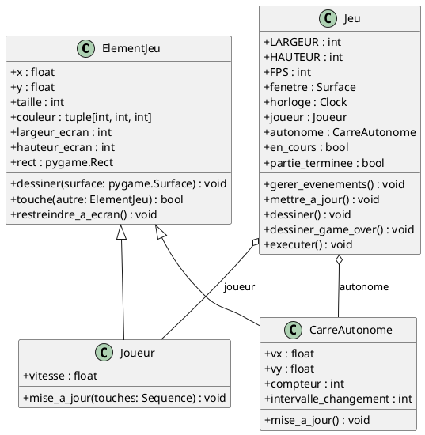

# **Pygame et Programmation Orientée Objet**

Dans le chapitre précédent, nous avons développé un jeu fonctionnel en mode procédural : un joueur contrôlable au
clavier, un carré autonome imprévisible, la détection de collision et un écran *Game Over*.

Cependant, regrouper toutes les variables et toute la logique au sein d'un script linéaire unique présente rapidement
des limites lorsque la complexité grandit. Ce chapitre montre comment refactoriser ce code vers une **architecture
orientée objet (POO)** propre, modulaire et extensible.

---

## **1. Pourquoi structurer un jeu en Orienté Objet ?**

Dans un jeu vidéo, la POO offre des avantages majeurs :

1. **Encapsulation de l'état et du comportement** : Chaque élément du jeu (joueur, ennemi, projectile) regroupe ses
   coordonnées, ses dimensions, sa vitesse et ses règles de déplacement au sein d'une même entité.
2. **Élimination des variables globales** : L'état global du jeu (fenêtre, score, booléens d'état, boucle principale)
   est géré proprement par une classe maîtresse `Jeu`.
3. **Réutilisabilité et Extensibilité (Héritage et Polymorphisme)** : Créer 20 ennemis différents ou de nouveaux types
   d'obstacles ne demande que quelques lignes sans jamais alourdir la boucle de jeu principale.
4. **Lisibilité de la boucle de jeu (*Game Loop Pattern*)** : La boucle principale se réduit à une orchestration claire
   et standardisée :
    - `gerer_evenements()`
    - `mettre_a_jour()`
    - `dessiner()`
    - `horloge.tick(FPS)`

---

## **2. Architecture et modélisation des classes**

Voici la structure de classes mise en place pour notre jeu :



---

## **3. Code complet : Version Orientée Objet**

Voici l'implémentation complète du jeu de collision restructuré en classes.

```python title="docs/src/section7/04_jeu_oo.py"
import random
import sys
import pygame


class ElementJeu:
    """Classe de base représentant un élément géométrique dans l'espace 2D du jeu."""

    def __init__(self, x: float, y: float, taille: int, couleur: tuple[int, int, int], limites: tuple[int, int]):
        self.x = x
        self.y = y
        self.taille = taille
        self.couleur = couleur
        self.largeur_ecran, self.hauteur_ecran = limites

    @property
    def rect(self) -> pygame.Rect:
        """Retourne le rectangle de délimitation (Hitbox) de l'élément."""
        return pygame.Rect(int(self.x), int(self.y), self.taille, self.taille)

    def dessiner(self, surface: pygame.Surface) -> None:
        """Affiche le carré sur la surface spécifiée."""
        pygame.draw.rect(surface, self.couleur, self.rect)

    def touche(self, autre: "ElementJeu") -> bool:
        """Détecte si cet élément entre en collision avec un autre élément."""
        return self.rect.colliderect(autre.rect)

    def restreindre_a_ecran(self) -> None:
        """Maintient l'élément à l'intérieur des bordures de la fenêtre."""
        self.x = max(0.0, min(float(self.largeur_ecran - self.taille), self.x))
        self.y = max(0.0, min(float(self.hauteur_ecran - self.taille), self.y))


class Joueur(ElementJeu):
    """Représente le carré contrôlé par l'utilisateur au clavier."""

    def __init__(
            self,
            x: float,
            y: float,
            taille: int = 50,
            couleur: tuple[int, int, int] = (70, 130, 180),
            limites: tuple[int, int] = (800, 600),
            vitesse: float = 5.0,
    ):
        super().__init__(x, y, taille, couleur, limites)
        self.vitesse = vitesse

    def mise_a_jour(self, touches: pygame.key.ScancodeWrapper) -> None:
        """Met à jour la position du joueur en fonction des touches pressées."""
        if touches[pygame.K_LEFT]:
            self.x -= self.vitesse
        if touches[pygame.K_RIGHT]:
            self.x += self.vitesse
        if touches[pygame.K_UP]:
            self.y -= self.vitesse
        if touches[pygame.K_DOWN]:
            self.y += self.vitesse

        self.restreindre_a_ecran()


class CarreAutonome(ElementJeu):
    """Représente un obstacle autonome doté d'une vitesse et d'un comportement aléatoire."""

    def __init__(
            self,
            x: float,
            y: float,
            taille: int = 40,
            couleur: tuple[int, int, int] = (220, 80, 80),
            limites: tuple[int, int] = (800, 600),
            intervalle_changement: int = 90,
    ):
        super().__init__(x, y, taille, couleur, limites)
        self.vx = float(random.choice([-4, -3, 3, 4]))
        self.vy = float(random.choice([-4, -3, 3, 4]))
        self.compteur = 0
        self.intervalle_changement = intervalle_changement

    def mise_a_jour(self) -> None:
        """Déplace le carré, gère les rebonds sur les murs et varie périodiquement la trajectoire."""
        # Déplacement
        self.x += self.vx
        self.y += self.vy

        # Rebonds sur les bordures horizontales
        if self.x <= 0:
            self.x = 0
            self.vx = abs(self.vx)
        elif self.x >= self.largeur_ecran - self.taille:
            self.x = float(self.largeur_ecran - self.taille)
            self.vx = -abs(self.vx)

        # Rebonds sur les bordures verticales
        if self.y <= 0:
            self.y = 0
            self.vy = abs(self.vy)
        elif self.y >= self.hauteur_ecran - self.taille:
            self.y = float(self.hauteur_ecran - self.taille)
            self.vy = -abs(self.vy)

        # Changement périodique de direction
        self.compteur += 1
        if self.compteur >= self.intervalle_changement:
            self.compteur = 0
            self.vx = float(random.randint(-5, 5))
            self.vy = float(random.randint(-5, 5))
            if self.vx == 0 and self.vy == 0:
                self.vx = 3.0


class Jeu:
    """Moteur principal orchestrant la boucle de jeu, les entités et l'affichage."""

    COULEUR_FOND = (30, 30, 30)
    COULEUR_TEXTE = (255, 255, 255)
    COULEUR_GAMEOVER = (230, 50, 50)

    def __init__(self, largeur: int = 800, hauteur: int = 600, fps: int = 60):
        pygame.init()
        self.largeur = largeur
        self.hauteur = hauteur
        self.fps = fps

        self.fenetre = pygame.display.set_mode((self.largeur, self.hauteur))
        pygame.display.set_caption("Pygame - Version Orientée Objet")
        self.horloge = pygame.time.Clock()

        # Polices
        self.police_titre = pygame.font.Font(None, 64)
        self.police_sous_titre = pygame.font.Font(None, 32)

        # Entités
        limites = (self.largeur, self.hauteur)
        self.joueur = Joueur(
            x=(self.largeur - 50) // 4,
            y=(self.hauteur - 50) // 2,
            taille=50,
            limites=limites,
        )
        self.autonome = CarreAutonome(
            x=(self.largeur - 40) * 3 // 4,
            y=(self.hauteur - 40) // 2,
            taille=40,
            limites=limites,
        )

        # État du jeu
        self.en_cours = True
        self.partie_terminee = False

    def gerer_evenements(self) -> None:
        """Traite les événements de la file Pygame."""
        for evenement in pygame.event.get():
            if evenement.type == pygame.QUIT:
                self.en_cours = False
            elif evenement.type == pygame.KEYDOWN:
                if evenement.key == pygame.K_ESCAPE:
                    self.en_cours = False

    def mettre_a_jour(self) -> None:
        """Met à jour l'état logique de la partie."""
        if self.partie_terminee:
            return

        touches = pygame.key.get_pressed()
        self.joueur.mise_a_jour(touches)
        self.autonome.mise_a_jour()

        if self.joueur.touche(self.autonome):
            self.partie_terminee = True

    def dessiner_game_over(self) -> None:
        """Affiche les messages de fin de partie à l'écran."""
        surface_titre = self.police_titre.render("GAME OVER", True, self.COULEUR_GAMEOVER)
        rect_titre = surface_titre.get_rect(center=(self.largeur // 2, self.hauteur // 2 - 30))
        self.fenetre.blit(surface_titre, rect_titre)

        surface_instruction = self.police_sous_titre.render(
            "Appuyez sur ESC pour quitter", True, self.COULEUR_TEXTE
        )
        rect_instruction = surface_instruction.get_rect(center=(self.largeur // 2, self.hauteur // 2 + 30))
        self.fenetre.blit(surface_instruction, rect_instruction)

    def dessiner(self) -> None:
        """Effectue le rendu graphique complet d'une trame."""
        self.fenetre.fill(self.COULEUR_FOND)

        # Dessin des entités
        self.joueur.dessiner(self.fenetre)
        self.autonome.dessiner(self.fenetre)

        if self.partie_terminee:
            self.dessiner_game_over()

        pygame.display.flip()

    def executer(self) -> None:
        """Lance et maintient la boucle principale du jeu."""
        while self.en_cours:
            self.gerer_evenements()
            self.mettre_a_jour()
            self.dessiner()
            self.horloge.tick(self.fps)

        pygame.quit()
        sys.exit()


if __name__ == "__main__":
    jeu = Jeu()
    jeu.executer()
```

---

## **4. Analyse détaillée des concepts OO appliqués**

### **4.1 La classe de base `ElementJeu` (Factorisation du code)**

Toutes les entités visibles du jeu partagent une position $(x, y)$, une taille, une couleur et des limites d'écran.

- **La propriété `@property rect`** : Calcule dynamiquement le `pygame.Rect` à partir des coordonnées flottantes. Cela
  permet à la fois d'avoir des déplacements continus et précis (nombres flottants) et d'obtenir instantanément la boîte
  englobante pour le rendu et les collisions.
- **La méthode `touche(autre)`** : Encapsule le test de collision géométrique entre deux objets du jeu sans exposer les
  détails d'implémentation.
- **La méthode `restreindre_a_ecran()`** : Empêche un élément de sortir des bordures de la fenêtre.

### **4.2 La sous-classe `Joueur` (Spécialisation et entrées utilisateur)**

- `Joueur` hérite de `ElementJeu` via `super().__init__(...)`.
- Sa méthode `mise_a_jour(touches)` reçoit directement le dictionnaire des touches pressées (`pygame.key.get_pressed()`)
  et modifie ses coordonnées de façon autonome.

### **4.3 La sous-classe `CarreAutonome` (Autonomie et dynamique temporelle)**

- `CarreAutonome` gère sa propre vitesse vectorielle $(v_x, v_y)$ et sa logique interne de rebond et de changement de
  direction.
- La classe principale du jeu n'a pas besoin de savoir *comment* le carré calcule son déplacement : elle appelle
  simplement `self.autonome.mise_a_jour()`.

### **4.4 La classe maîtresse `Jeu` (Patron Façade / Chef d'orchestre)**

- Encapsule toutes les ressources globales : fenêtre Pygame, polices, horloge, entités et état du jeu (`en_cours`,
  `partie_terminee`).
- Découpe la boucle de jeu en sous-fonctions spécialisées selon le principe de responsabilité unique (*Single
  Responsibility Principle*) :
    1. `gerer_evenements()` : capture les clics de fermeture et les frappes de touches ponctuelles (`K_ESCAPE`).
    2. `mettre_a_jour()` : avance la logique des entités et évalue les collisions.
    3. `dessiner()` : gère le rendu visuel et bascule les tampons d'affichage (*Double Buffering*).
    4. `executer()` : boucle de jeu centrale concise et élégante.

---

## **5. Puissance de la POO : Facilité d'extension**

Grâce à cette conception, ajouter de nouvelles fonctionnalités devient trivial et ne perturbe pas le reste du système.

### **Exemple : Gérer une horde d'obstacles autonomes**

Pour passer de 1 seul carré autonome à 10 carrés autonomes, il suffit de modifier la classe `Jeu` :

```python
# Dans Jeu.__init__() :
self.obstacles = [
    CarreAutonome(
        x=random.randint(200, self.largeur - 50),
        y=random.randint(50, self.hauteur - 50),
        taille=random.randint(25, 45),
        limites=limites
    )
    for _ in range(10)
]

# Dans Jeu.mettre_a_jour() :
for obstacle in self.obstacles:
    obstacle.mise_a_jour()
    if self.joueur.touche(obstacle):
        self.partie_terminee = True

# Dans Jeu.dessiner() :
for obstacle in self.obstacles:
    obstacle.dessiner(self.fenetre)
```

Aucune modification n'est requise dans `ElementJeu`, `Joueur` ou `CarreAutonome`. C'est le principe **Ouvert/Fermé (
Open/Closed Principle)** : le code est ouvert à l'extension, mais fermé à la modification.

---

## **6. Vers les fonctionnalités avancées de Pygame : `pygame.sprite.Sprite`**

Pygame propose également un module intégré dédié aux entités de jeu : `pygame.sprite`.

Dans ce modèle standard :

- Vos entités héritent de `pygame.sprite.Sprite`.
- Elles possèdent obligatoirement un attribut `self.image` (Surface) et `self.rect` (Rect).
- Elles sont regroupées dans des conteneurs `pygame.sprite.Group()`.
- Le groupe gère automatiquement l'appel de `update()` sur toutes les entités, leur dessin en une seule ligne
  (`group.draw(surface)`) et des fonctions optimisées de détection de collisions de groupe
  (`pygame.sprite.spritecollide`).

---

## **7. Exercices pratiques proposés**

1. **Recommencer la partie (*Restart*)** :
    - Ajoutez dans `gerer_evenements()` la possibilité d'appuyer sur la touche **R** (`pygame.K_r`) lorsque
      `partie_terminee == True` pour réinitialiser la position du joueur et des obstacles sans relancer le script.

2. **Système de points et survie** :
    - Ajoutez un attribut `score` à la classe `Jeu`.
    - Incrémentez le score de 1 point par seconde de survie (ou utilisez `pygame.time.get_ticks()`) et affichez-le en
      haut de l'écran.

3. **Différents types d'ennemis (Polymorphisme)** :
    - Créez une nouvelle classe `EnnemiSuiveur(ElementJeu)` dont le déplacement est toujours orienté vers la position
      actuelle du joueur.
    - Intégrez un `EnnemiSuiveur` en plus des carrés autonomes existants.
