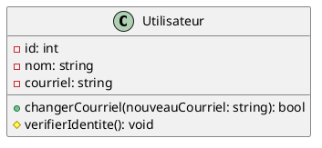
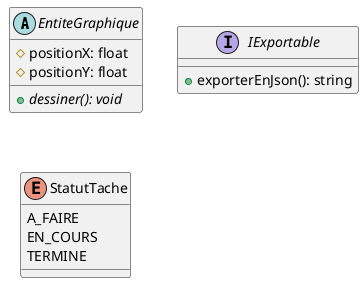
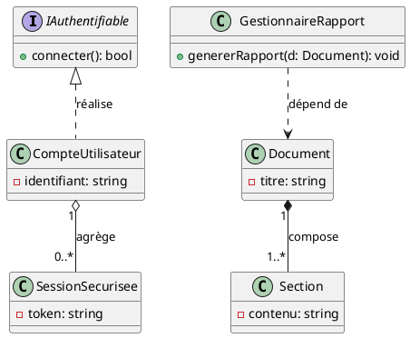
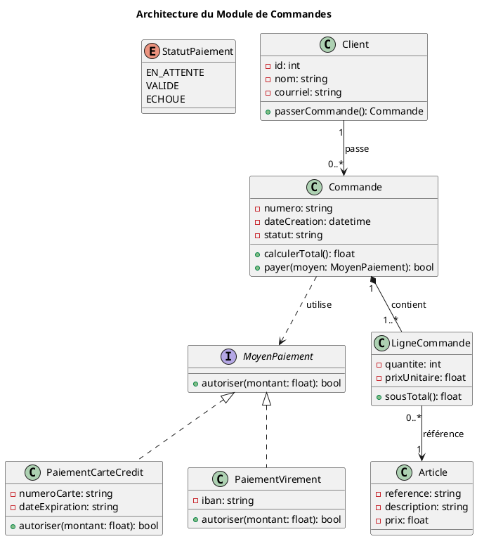

# Modélisation : Créer des diagrammes de classes avec PlantUML

La modélisation orientée objet n'est pas un exercice abstrait ou décoratif : sa valeur réside dans sa capacité à
maximiser le succès d'un projet en minimisant les coûts de refactorisation, en réduisant la dette technique et en
optimisant la communication au sein d'une équipe. Concevoir un diagramme de classes avant ou pendant le développement
permet de clarifier la structure logicielle, d'anticiper les goulots d'étranglement conceptuels et de garantir que
chaque ligne de code produite contribue directement à la résolution du problème.

---

## 1. Survol des éléments fondamentaux et syntaxe PlantUML

Pour minimiser la charge cognitive lors de la lecture et maximiser la maintenabilité, PlantUML utilise une syntaxe
textuelle concise.

Dans votre documentation MkDocs :

- Les blocs ````puml```` génèrent le rendu visuel.
- Les blocs ````plantuml```` affichent le code source pour que les étudiants puissent l'étudier ou le réutiliser.

### A. Classes, Attributs et Méthodes

Une classe regroupe des données (attributs) et des comportements (méthodes). La visibilité permet d'encapsuler les
responsabilités pour réduire le risque d'effets de bord indésirables.

- `+` : `public` (accessible par tous)
- `-` : `private` (accessible uniquement par la classe elle-même)
- `#` : `protected` (accessible par la classe et ses sous-classes)
- `~` : `package` / `internal`

Rendu visuel :



Code PlantUML correspondant :


### B. Types particuliers : Classes abstraites, Interfaces et Énumérations

Structurer clairement les contrats d'interface et les abstractions permet de découpler les modules, facilitant les tests
unitaires et la réutilisation du code.

Rendu visuel :



Code PlantUML correspondant :


---

## 2. Relations entre classes et cardinalités

Définir précisément les relations apporte le plus grand gain de clarté pour l'architecture. Une mauvaise qualification
des liens entre objets engendre souvent des dépendances cycliques ou une gestion de mémoire inefficace.

| Relation        | Signification pragmatique                                       | Syntaxe PlantUML   |
|:----------------|:----------------------------------------------------------------|:-------------------|
| **Héritage**    | Spécialisation / Polymorphisme ("est un")                       | `<\|--` ou `--\|>` |
| **Réalisation** | Implémentation d'un contrat d'interface                         | `<\|..` ou `..\|>` |
| **Composition** | Dépendance de cycle de vie forte (la partie meurt avec le tout) | `*--` ou `--*`     |
| **Agrégation**  | Conteneur d'objets indépendants (cycle de vie partagé)          | `o--` ou `--o`     |
| **Association** | Référence simple / navigation directionnelle                    | `-->` ou `--`      |
| **Dépendance**  | Utilisation ponctuelle (paramètre de méthode, création locale)  | `..>`              |

Rendu visuel :



Code PlantUML correspondant :


---

## 3. Méthodologie active pour concevoir un diagramme de classes

Pour rentabiliser au maximum le temps investi dans la conception, il est conseillé de suivre une démarche itérative
orientée vers la valeur fonctionnelle :

### Étape 1 : Identifier les entités du domaine

- **Action** : Extraire les substantifs pertinents des exigences ou du cahier des charges.
- **Principe d'utilité** : Éviter de modéliser chaque variable ou détail technique mineur dès le début. Concentrez-vous
  sur les concepts qui stockent un état durable ou coordonnent des flux de travail.

### Étape 2 : Répartir les responsabilités (Cohésion forte, Faible couplage)

- **Action** : Assigner à chaque classe un rôle unique et cohérent (principe de responsabilité unique).
- **Principe d'utilité** : Réduire le couplage évite qu'une modification locale n'entraîne une cascade de bogues dans le
  reste du système.

### Étape 3 : Qualifier les relations et cardinalités

- **Action** : Poser la question de la durée de vie et de la propriété des objets :
    - *Si l'objet parent est supprimé, que deviennent les enfants ?*
        - S'ils disparaissent : **Composition** (`*--`).
        - S'ils continuent d'exister indépendamment : **Agrégation** (`o--`).
    - *La classe manipule-t-elle l'autre uniquement dans une méthode ?*
        - C'est une **Dépendance** (`..>`).

### Étape 4 : Raffiner les signatures utiles

- **Action** : Spécifier les méthodes publiques principales qui constituent l'API interne du composant.
- **Principe d'utilité** : Ne surchargez pas le schéma avec des accesseurs/mutateurs triviaux (`get/set`) sauf s'ils
  portent une logique métier significative.

---

## 4. Exemple complet d'application de projet

Voici un exemple concret représentant un module de gestion de commandes et de paiements, structuré pour apporter une
lisibilité optimale.

Rendu visuel :



Code PlantUML correspondant :


---

## 5. Bonnes pratiques pour maximiser l'efficacité de modélisation

- **Rester au niveau d'abstraction adapté** : Un diagramme de classes doit éclairer la prise de décision architecturale,
  pas reproduire l'intégralité du code source ligne par ligne.
- **Rendre les diagrammes modulaires** : Si un projet dépasse 10 à 15 classes, divisez-le en sous-diagrammes par
  paquetage/module fonctionnel pour éviter la surcharge visuelle.
- **Aligner le code et le modèle de façon continue** : Mettre à jour le diagramme au fur et à mesure que les choix de
  conception évoluent évite l'accumulation d'informations obsolètes qui nuisent à l'équipe.